# SAP TechEd Developer Garage: Publish and Subscribe to Events in SAP Integration Suite, Advanced Event Mesh

<!-- description --> Get started with your first message exchange using the Try Me! UI in SAP Integration Suite, Advanced Event Mesh (AEM). Explore topics, queues, topic hierarchies, wildcards, and the difference between direct and persistent message delivery modes.

## Overview

SAP Integration Suite, advanced event mesh is SAP's flagship event broker — a fully managed event streaming and management service that enables enterprise-wide, enterprise-grade event-driven architecture.

In this tutorial you will explore AEM hands-on using its built-in **Try Me!** tool. You will create a queue, subscribe it to a topic, publish messages, experiment with topic hierarchies and wildcards, and experience the difference between direct (non-persistent) and guaranteed (persistent) message delivery.

## Prerequisites

- Access to an SAP Integration Suite, Advanced Event Mesh tenant

## You will learn

- How to access AEM and take your first steps
- What topics are and how they work in AEM
- How to send and receive messages via the **Try Me!** page in the event broker service
- The difference between direct and persistent message delivery modes

---

### Introduction — What is SAP Integration Suite, Advanced Event Mesh


SAP Integration Suite, advanced event mesh is a fully managed event streaming and management service that enables enterprise-wide and enterprise-grade event-driven architecture. It is a full-blown, general-purpose event mesh offering enterprise-grade performance, reliability, security, and governance. It scales to very large use cases.

Use the link and credentials below to log in:

| Resource | Value |
| ---------- | ------- |
| AEM console | https://url.sap/y3fiys |
| Login user | **DevGarageAEM** |
| Password | Provided by your session moderator |

Key characteristics:

- Distributed mesh of event brokers deployable across cloud and on-premise environments
- Full-purpose set of eventing services covering all relevant use cases
- Supports event streaming, event management, and event monitoring
- Brokers scale as required and come in different sizes to fit different needs

SAP Integration Suite, advanced event mesh:

- Is a general-purpose, multi-site EDA platform and portal
- Allows SAP-to-SAP, SAP-to-everything, and everything-to-everything scenarios
- Supports distributed networks of event brokers deployed in different clouds and on-premises
- Can be deployed in your cloud of choice or in your on-premises Kubernetes environment
- Provides sophisticated authentication and security (Kerberos, OAuth, TLS)
- Offers fine-grained filtering options
- Enables real-time monitoring, capacity insights, and distributed tracing
- Supports all relevant protocols: JMS, REST, AMQP, MQTT, and SMF
- Scales from small to billions of events per day

Features you will touch in this tutorial include:

- AEM queues
- AEM Cluster Manager
- AEM Mesh Manager
- AEM Event Designer and Event Management
- AEM **Try Me!** tool
- AEM Event Portal

---

### Log into Advanced Event Mesh and explore the cockpit


1. Log into Advanced Event Mesh using the credentials from the Prerequisites section.

  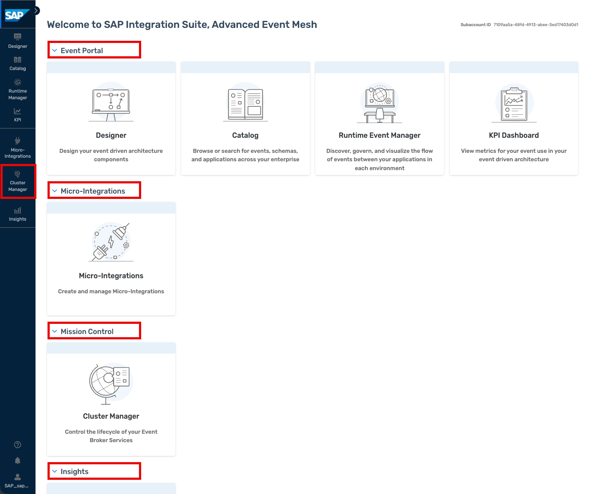

2. Explore the **Advanced Event Mesh cockpit**. The different areas represent the main categories of services AEM offers:

   - **Mission Control** — Deploy event brokers, create event meshes, and monitor health and performance.
     - **Cluster Manager** — Event broker services are available here. Each service consists of event brokers configured in a High-Availability (HA) setup.
     - **Mesh Manager** — Connect multiple event broker services across data centers to create an event mesh. An event mesh is an architectural layer that allows events from one application to be dynamically routed to any other application regardless of where they are deployed.
   - **Event Portal** — Event management services providing tools to create, design, share, and manage aspects of an EDA based on event brokers or other streaming technologies such as Kafka.
   - **Event Monitoring and Insights** — Curated dashboards, visualizations based on historical and real-time metrics, and notifications about your event broker services.

3. Click on **Cluster Manager**.

  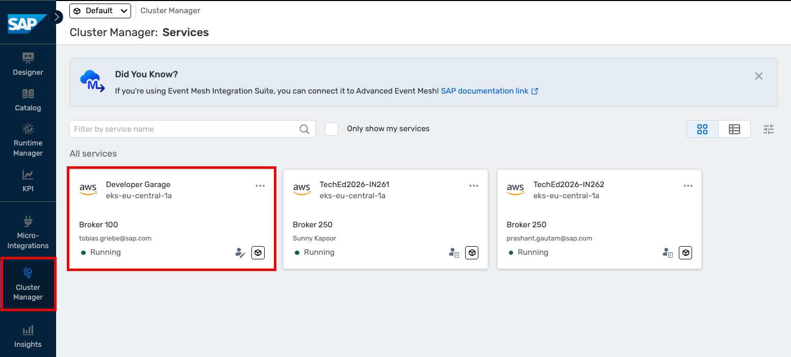

4. Select the **Developer Garage** broker by clicking on it.

5. Click **Open Broker Manager**.

  > The Broker Manager opens in a new browser tab. Keep both tabs open — you will need both.

  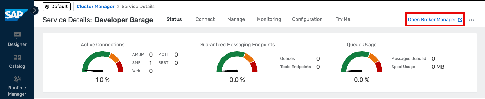

6. Explore the **Broker Manager**.

  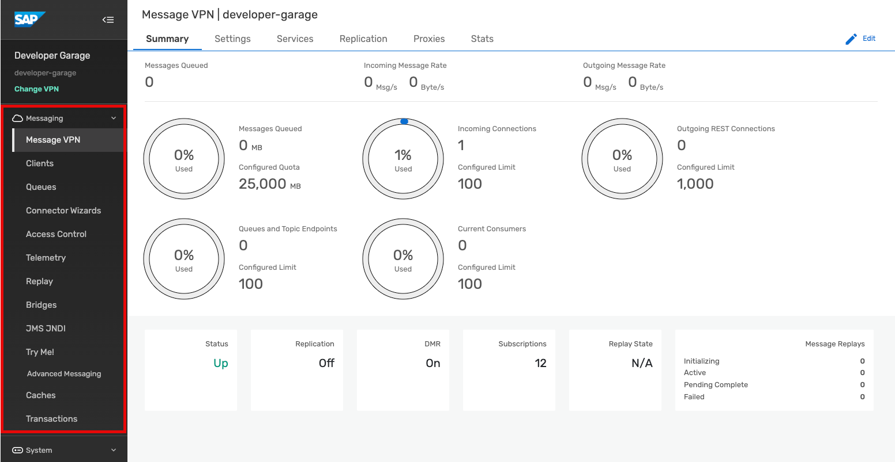

  On the left side you will find the main navigation sections:

  - **Message VPN** — VPN-level stats and configuration. One AEM broker can host multiple Message VPNs, each with different authorization schemes and topic spaces.
  - **Clients** — Information about connected and configured client applications.
  - **Queues** — Used for guaranteed/persistent messaging.
  - **Connectors** — Wizards to connect to a variety of web services.
  - **Access Control** — Create client usernames, ACL profiles, and client profiles.
  - **Replay** — Enable replay to allow the broker to re-send previous messages.
  - **Try Me!** — Connect two WebSocket test applications to publish and subscribe to messages.

### Create a queue in Advanced Event Mesh

After completing this step you will have created a queue in Advanced Event Mesh.

1. Go back to the original browser tab and click on **Cluster Manager** on the left.

2. In the **All Services** screen, click on the **Developer Garage** tile.


3. Press **Manage**.

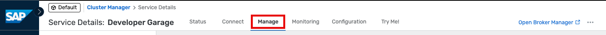

4. Under **Broker Manager Quick Settings**, click the **Queues** link. A new window opens.

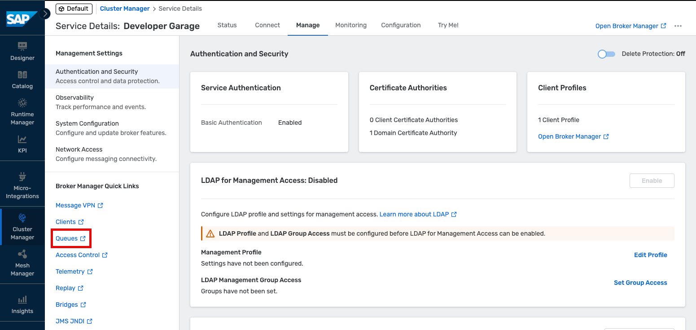

5. Click the **+ Queue** button in the top right.

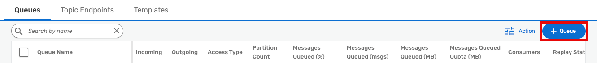

6. In the pop-up, enter a **queue name** — use something unique like your initials or a nickname.

7. Click **Create**.

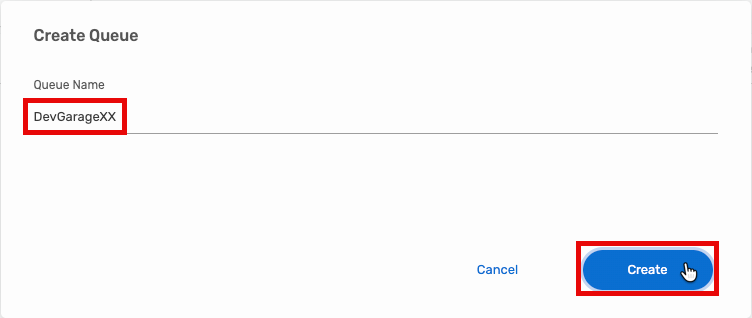

8. On the next screen, click **Apply**.

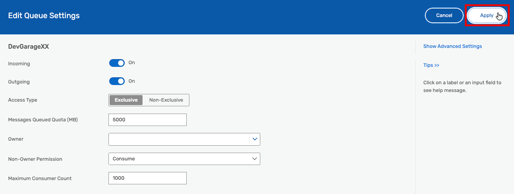

9. Verify that your queue appears in the list.

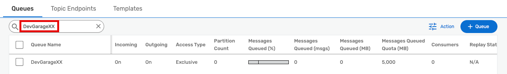

### Create a queue subscription in Advanced Event Mesh

After completing this step you will have subscribed your queue to a topic.

1. Click on your queue.

2. Click on **Subscriptions**.

3. Click the **+ Subscription** button.

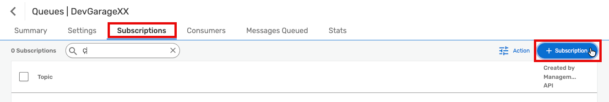

4. Enter a topic into the field. Use something unique like your initials or a nickname as `<unique_topic>`.

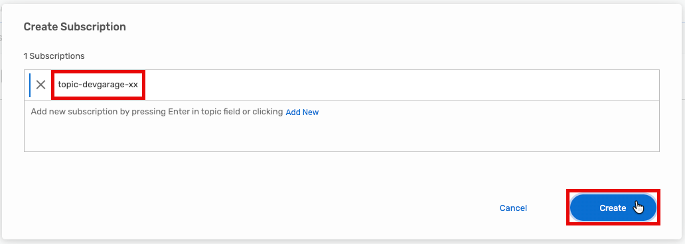

> **Note:** This topic is intentionally simple to facilitate the exercise. In real-world scenarios you can work with topic hierarchies that allow for filtering, and with dynamic topics based on event data. All UTF-8 characters are generally allowed in topic names. Topic strings are strictly case-sensitive (`a/b/c` differs from `A/B/C`). Topics can have up to 128 levels and a maximum length of 250 bytes.

5. Click **Create**.

6. Verify that your queue subscription was created.

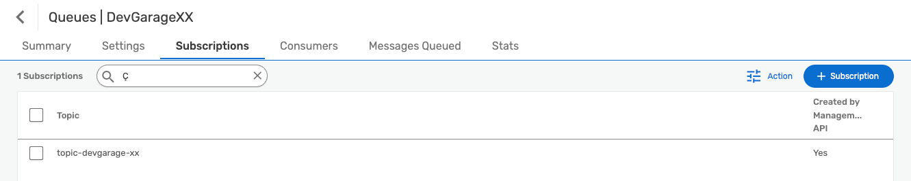

### Send a message using the Try Me! tool

After completing this step you will have sent your first message to a topic and confirmed it was delivered to your queue.

1. Switch to the **Try Me!** section in the left-hand menu.

2. Press the **expand** icon to show the connection details.

> The connection properties must be adjusted before you can connect — you will fill them in from the connection details screen.

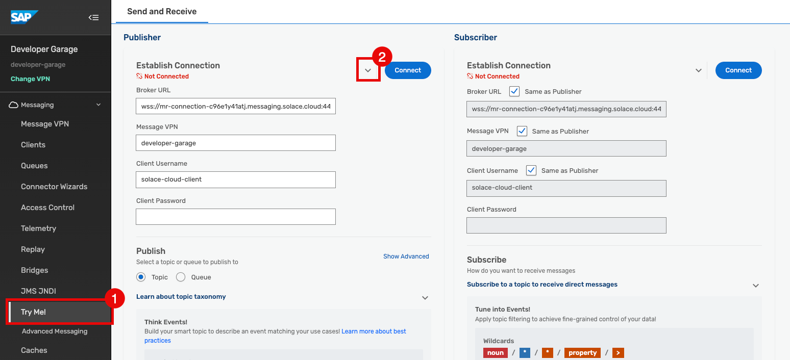

3. Keep this tab open and **go back to the other/main tab**. Click **Connect** and select **View by "Protocol"**.

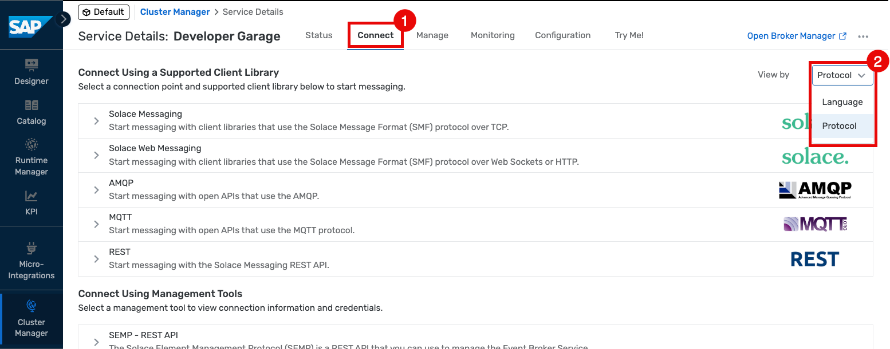

4. Open the **Solace Web Messaging** entry and select **Solace JavaScript API**. A pop-up on the right shows the connection details.

5. Copy the **Password** and **Host URI** into the corresponding properties in the **Try Me!** tool. Overwrite the existing placeholder values.

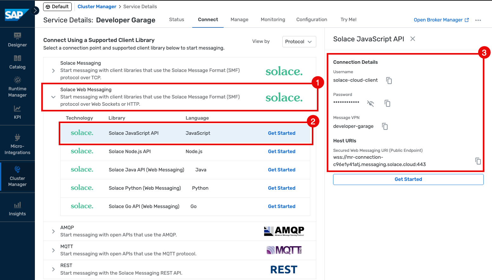

6. Click **Connect** in the **Publisher** section.

> **Important:** If your browser asks you to select a certificate for authentication, press **Cancel** — selecting a certificate will cause the connection to fail. If you accidentally selected a certificate, restart your browser to see the dialog again.

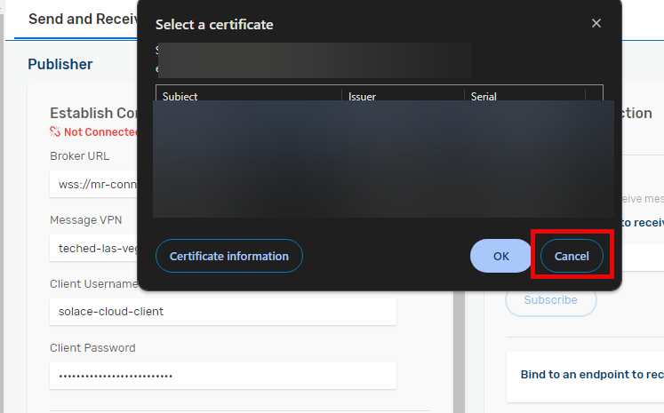

7. Enter your unique topic (the same one you used in step 4) into the topic field.

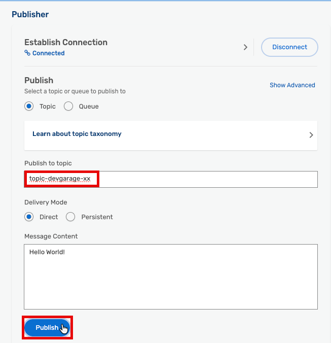

8. Click **Publish** to send your message (default payload: *Hello World!*) to your topic.

9. Verify that **1 message published** appears in the **Publish Status**.


10. Switch back to the **Queues** view.

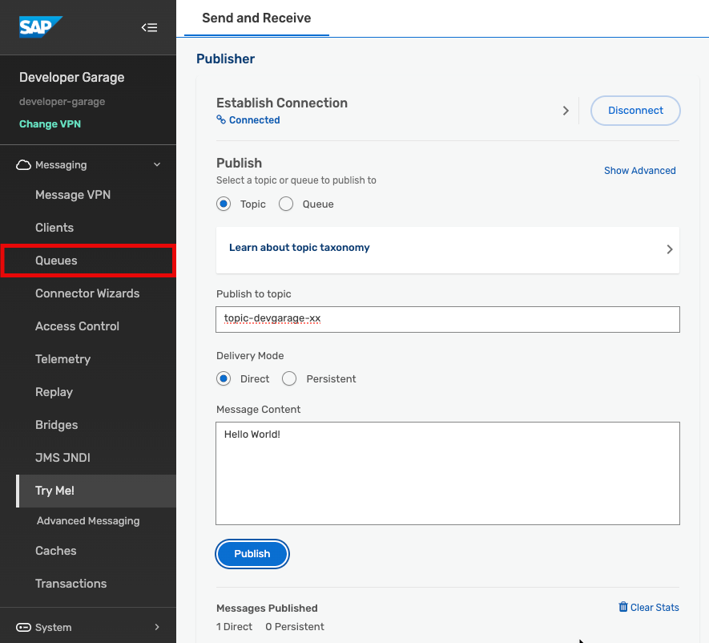

11. Find the queue you created earlier. You should see **1 message queued**.

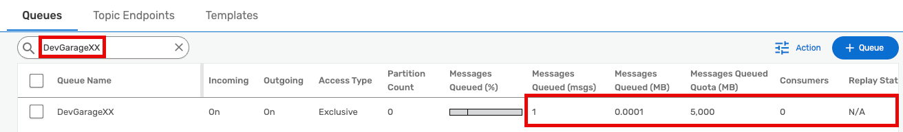

You have published a message to a topic, and via the subscription that message has been stored in your queue.

12. Optional: Return to the **Try Me!** tool and click **Publish** several more times. Switch back to the **Queues** tab and refresh — observe the message count increasing. Clicking on your queue shows a more detailed summary.

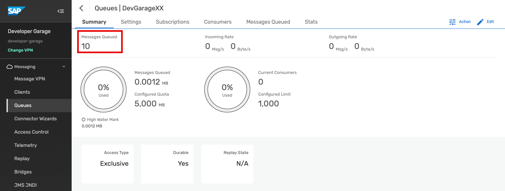

### Understand topic hierarchies and wildcards

After completing this step you will have learned about **topic hierarchies and wildcards** and practised using them.


#### What are topic hierarchies?

Advanced Event Mesh supports a hierarchical topic structure, which means you can be very descriptive when defining your topic. Use it to describe the **contents and intent of your message payload data**.

Each message can be published to a unique topic depending on the event metadata. Examples of valid AEM topics:

- `hello/world/aem`
- `acme/taxi/rider/hail`
- `city/train/1234/alert/stopped`
- `mfg/plant42/inv/update/p12345667`
- `payme/debit/qr/bank01/f89a09-2b9c065a3/ok`

Topics for events originating from SAP S/4HANA follow a standard structure:

- `ce/sap/s4/beh/salesorder/v1/SalesOrder/Changed/v1`
- `ce/sap/s4/beh/businesspartner/v1/BusinessPartner/Created/v1`
- `ce/sap/s4/beh/workcenter/v1/WorkCenter/Created/v1`

#### Subscription wildcards

Because published topics can be so variable and dynamic, subscribers can use wildcards to match a single subscription to multiple published topics. AEM supports two wildcard types:

- **Single-level wildcard** (`*`) — matches 0 or more characters up to the next level `/`. Can be used with a prefix (e.g. `abc*`) but not a suffix.
- **Multi-level wildcard** (`>`) — matches one or more levels. Must appear at the end of the topic subscription.

Examples of subscriptions and the topics they match:


#### Practise topic hierarchies with the Try Me! tool — Berlin edition

Now that you understand topic hierarchies, use the **Try Me!** tool to experiment with them. You will use Berlin-themed topics.


1. Go to the **Try Me!** tool used in the previous step.

2. Connect both the **Publisher** and **Subscriber** by clicking their **Connect** buttons. You may still be connected from the previous step.

3. Clear any existing subscriptions in the Subscriber so you start fresh.

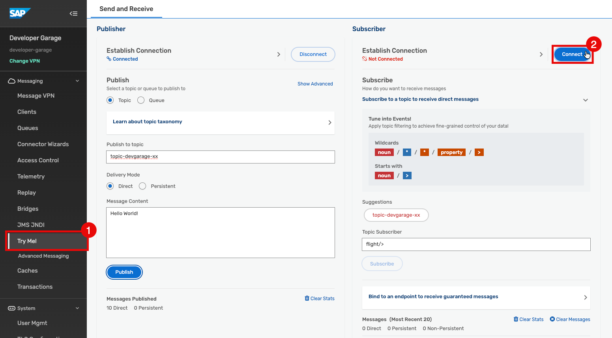

4. Review the hierarchical categorisation of Berlin-related topics below.

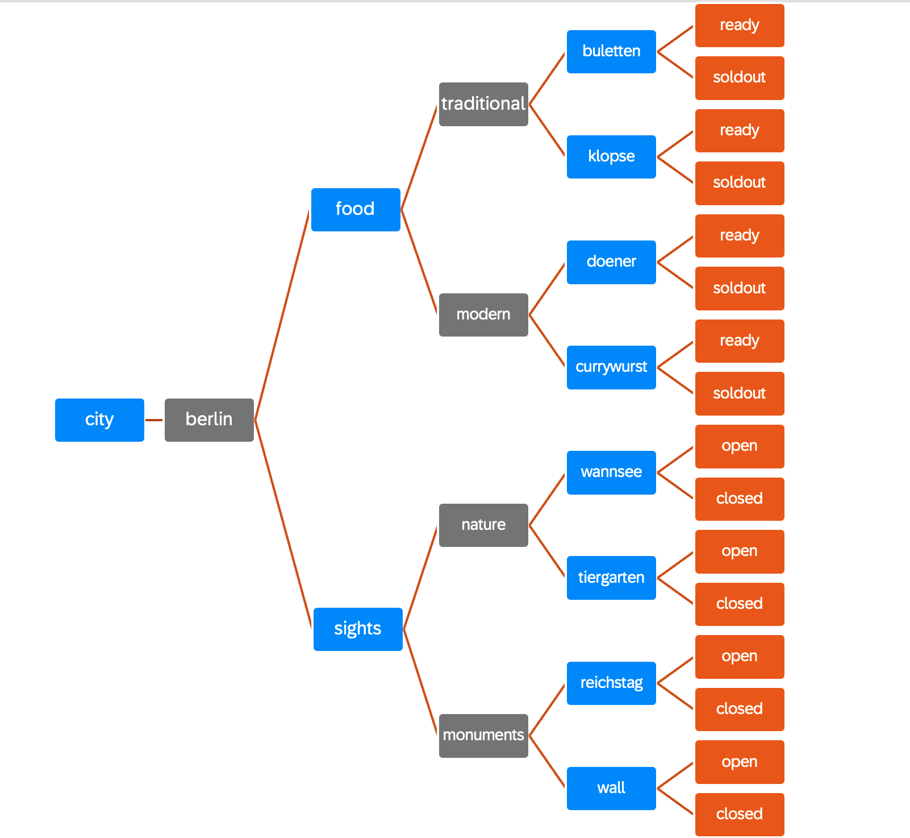

> **Note:** If you publish to a shared topic, other participants will receive your event too — that is exactly how topics work! If you want to experiment privately, prefix your topics with your participant number (e.g. `42/city/berlin/food/modern/currywurst/ready`). Use the same prefix when subscribing.

5. Subscribe the consumer to `city/berlin/food/modern/currywurst/*` to listen for all currywurst events.

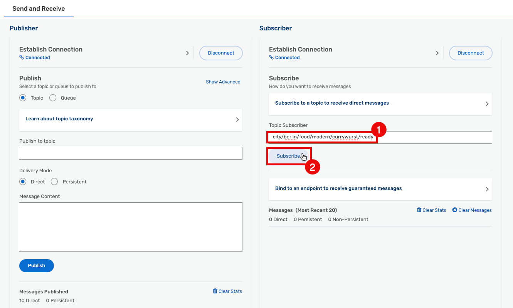

6. In the **Publisher**, set the topic to `city/berlin/food/modern/currywurst/ready`, add a payload (e.g. *medium spicy currywurst for Scott*), and click **Publish**.


7. Verify that you receive the message in the **Subscriber**.


8. Now experiment with sights. Remove your current subscriptions.


9. Subscribe to `city/berlin/sights/*/*/open`.

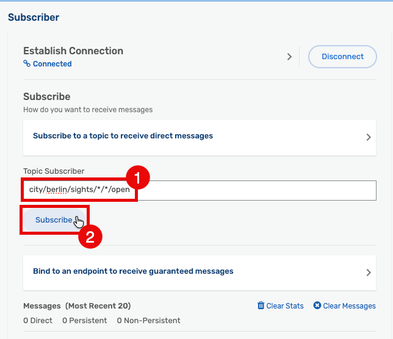

10. Publish an event with topic `city/berlin/sights/monuments/reichstag/open`.


11. Try additional combinations on your own using the topic list below:

```
city/berlin/sights/monuments/reichstag/open
city/berlin/sights/monuments/reichstag/closed
city/berlin/sights/monuments/wall/open
city/berlin/sights/monuments/wall/closed
city/berlin/sights/nature/wannsee/open
city/berlin/sights/nature/wannsee/closed
city/berlin/sights/nature/tiergarten/open
city/berlin/sights/nature/tiergarten/closed
city/berlin/food/traditional/buletten/ready
city/berlin/food/traditional/buletten/soldout
city/berlin/food/traditional/klopse/ready
city/berlin/food/traditional/klopse/soldout
city/berlin/food/modern/doener/ready
city/berlin/food/modern/doener/soldout
city/berlin/food/modern/currywurst/ready
city/berlin/food/modern/currywurst/soldout
```

### Understand persistent and non-persistent message delivery

After completing this step you will have learned about delivery modes, persistency, and quality of service, and seen the practical difference in the **Try Me!** tool.


#### Delivery modes and quality of service

Advanced Event Mesh supports two delivery modes:

**Persistent (Guaranteed)**
- Messages are placed onto non-volatile storage after arriving at the broker.
- The broker sends an acknowledgment back to the producer after successfully storing the message.
- If a subscriber wants guaranteed delivery, they must set up a queue (or topic endpoint) and add their subscription there — this is called **topic-to-queue mapping**. The broker stores all matching messages and delivers them losslessly. The consumer acknowledges each message, after which the broker removes it from the queue.
- Also known as: *Guaranteed Messaging*, *QoS1/QoS2*, *at-least-once delivery*.

**Non-Persistent (Direct)**
- Messages are only stored if subscribed by a queue or durable topic endpoint.
- Publisher and subscriber must both be connected at the same time for delivery to succeed — messages published while the subscriber is offline are lost.
- Fastest mode, but not lossless.
- Also known as: *Direct Messaging*, *QoS0*, *at-most-once delivery*.

#### Experiment with persistency

1. Remove all subscriptions from your Subscriber and clear the messages.

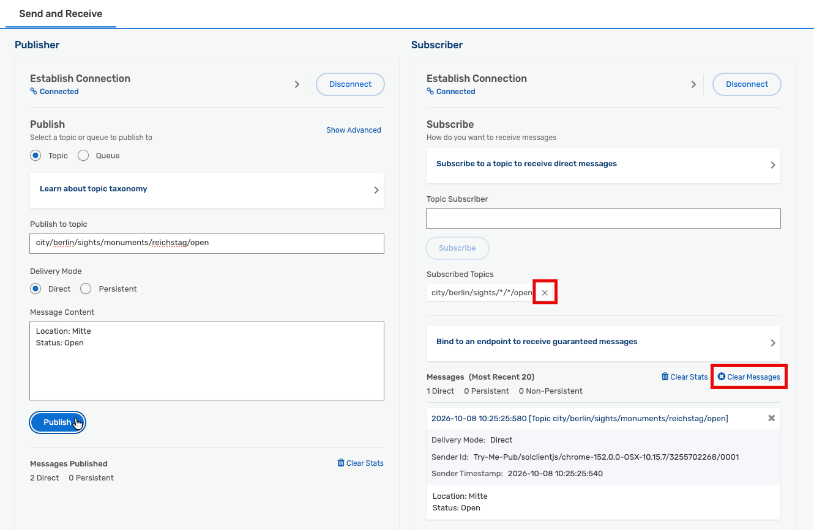

2. In the Publisher, enter your unique topic from the earlier exercises and publish **one message** using direct (non-persistent) mode.


> Did you receive anything? No — your Subscriber is not yet subscribed to the topic.

3. Subscribe the Subscriber to your unique topic and click **Subscribe**.

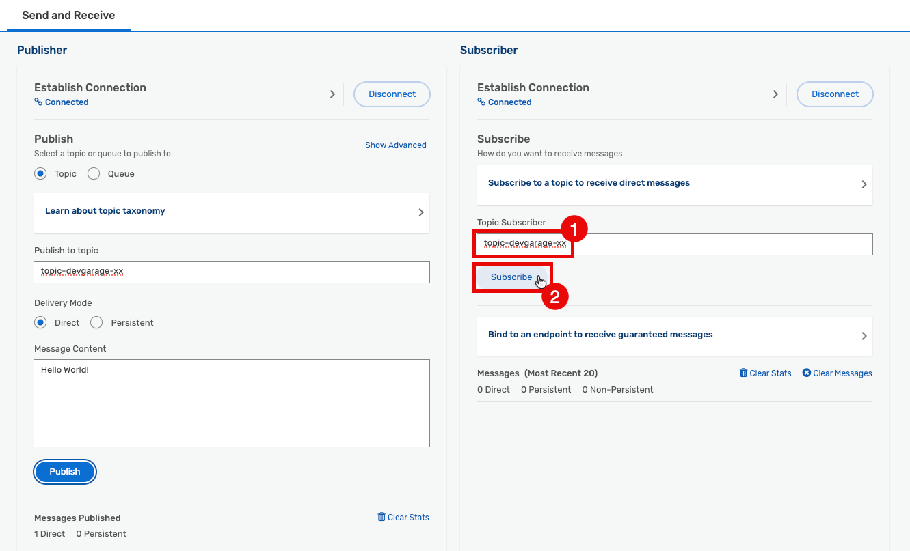

> Did you receive the message now? Still no. Your subscriber is using direct/non-persistent mode. There is no persistent endpoint, so messages published while the subscriber was not listening are gone.

4. Click **Publish** one more time.

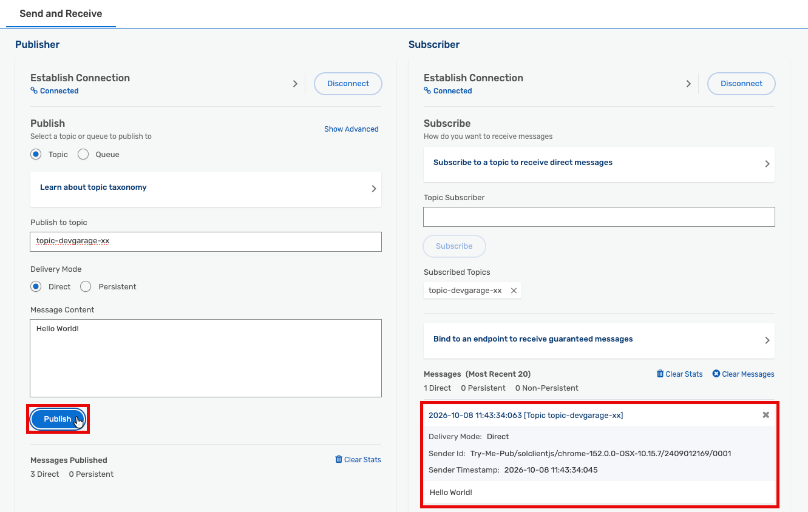

> Now you receive a message — because publisher and subscriber are both connected at the same time. This is **non-persistent messaging**: publishers and subscribers must be connected simultaneously. It is the fastest mode but offers no delivery guarantee.

5. Publish a few more messages, then clear the Subscriber's messages and remove the topic subscription.


6. Click **Bind to an endpoint to receive guaranteed messages**, then enter the unique queue name you created in the **Create a queue** step.


7. Click **Start Consume**.


> You should now receive multiple messages at once. How? Your queue has been subscribed to your topic the entire time. Every message you published to that topic was attracted to the queue by its subscription and stored there. When you started consuming from the queue, the broker delivered all stored messages immediately.
>
> This is **persistent messaging**: publishers and consumers do not need to be online at the same time or process messages at the same speed. The broker securely stores all messages matching the queue's subscription and delivers them when the consumer is ready.

### Clean up


Please delete the artifacts you created during this tutorial to keep the shared environment clean for all participants.

1. Click on **Queues**.
2. Search for your queue.
3. Select your queue from the list.
4. Click the **Action** button.
5. Select **Delete** to delete your queue and all currently stored messages.
6. Repeat for any other artifacts you may have created.


## Summary

In this tutorial you have:

1. Explored the SAP Integration Suite, Advanced Event Mesh cockpit, Cluster Manager, and Broker Manager.
2. Created a queue and subscribed it to a topic.
3. Published messages using the **Try Me!** tool and confirmed delivery to your queue.
4. Learned how topic hierarchies and wildcards enable flexible, descriptive event routing.
5. Experienced the practical difference between direct (non-persistent) and guaranteed (persistent) message delivery.

To dive deeper, join the TechEd 2026 hands-on session: [IN163: Build your own event-driven scenario with advanced event mesh](https://www.sap.com/events/teched/berlin/flow/sap/te26/catalog/page/catalog/session/1786029069284001qBM4).
