# SAP TechEd Developer Garage: AWS Pipeline for Revenue Management

<!-- description --> Build an integration flow in SAP Integration Suite that reads a sales file from Amazon S3, looks up unit costs in a reference file in S3, calculates profit margin, and writes the enriched data to a second S3 bucket in another region.

## You will learn

- How to build an integration flow from scratch in SAP Integration Suite
- How the AWS adapters use credentials that have been provisioned for you
- How the AmazonWebServices adapter reads and writes files in Amazon S3
- How to enrich messages with a reference-data lookup and calculate profit margin in Groovy
- How to deploy an integration flow and follow a message step by step in the Monitor

## Prerequisites

- Contact a Developer Advocate in the Developer Garage to share the necessary credentials for accessing the provisioned systems.
- Various systems have been provisioned for you to complete this tutorial.

### System access

As part of this tutorial, you will need to access the provisioned systems using the credentials shared with you. In the table below, you will find the necessary information to access each system.

> There are two SAP Integration Suite environments available for use in this tutorial. Use the one corresponding to your user range.

| System | URL |
| --- | --- |
| SAP Integration Suite - Dev Garage 1 (User01 - User99) | <https://url.sap/054nme> |
| SAP Integration Suite - Dev Garage 2 (User100 - User180) | <https://url.sap/i18ebv> |

## Scenario

**Company:** A retailer with regional stores

**Challenge:** Every store drops its sales extract (CSV) into an Amazon S3 "landing" bucket. Finance wants profit margin per sale, but the sales file only contains prices. Unit costs live in a separate reference file.

**Data sources:**

| Source | Location | Content |
| :--- | :--- | :--- |
| Sales file | `regional-landing-bkt/daily/sales_2026-10-14.csv` (region `eu-north-1`) | One row per sale: store, region, product, quantity, price |
| Reference file | `regional-landing-bkt/reference/product_master.csv` (region `eu-north-1`) | Unit cost of each of the 15 products |
| Curated output | `curated-corp/profit-margins/` (region `us-west-1`) | The enriched sales data, written by your flow |

**Goal:** Calculate profit margin, a number that exists nowhere in the source file, for every sale, write the enriched data to the curated bucket, and summarize the run.

The AmazonWebServices adapter is the hero of this flow. You use it three times: to read the sales file, to read the reference file, and to write the result.

The flow you'll build:

```text
Start Timer                 (runs the flow once each time you deploy)
  -> Read Sales File          (Request Reply -> S3 read: daily/sales_2026-10-14.csv)
  -> CSV to XML Converter     (CSV -> structured XML, using xml_schema.xsd)
  -> XML to JSON Converter    (XML -> JSON)
  -> Prepare for Lookup       (Content Modifier: ingestion metadata, stash the sales JSON)
  -> Cost LookUp              (Request Reply -> S3 read: product_master.csv)
  -> Margin Calculation       (Groovy: profit margin per sale + run summary)
  -> S3 Write                 (Request Reply -> S3 write: curated-corp/profit-margins/)
  -> Show Run Summary         (Content Modifier: run summary in the body)
  -> End
```

| Part of the flow | What it does |
| :--- | :--- |
| **Start Timer** | Starts the flow once, each time you deploy. No sender system is needed. |
| **Read Sales File** | Reads `sales_2026-10-14.csv` from the `daily/` folder and leaves the file in place |
| **CSV to XML Converter** | Gives each row named fields, using the `xml_schema.xsd` schema |
| **XML to JSON Converter** | Turns the XML into JSON, the shape the rest of the flow works with |
| **Prepare for Lookup** | Records when and where the file was ingested, and sets the sales data aside so it survives the next step |
| **Cost LookUp** | Reads `product_master.csv` from `regional-landing-bkt/reference/` |
| **Margin Calculation** | Adds unit cost, gross margin, and margin percentage to each sale, and builds the run summary |
| **S3 Write** | Writes the enriched JSON to `curated-corp/profit-margins/` |
| **Show Run Summary** | Puts the run summary in the message, so it's the last thing you see in the Monitor |

By the end of the exercise, you will have an integration flow like the one below:

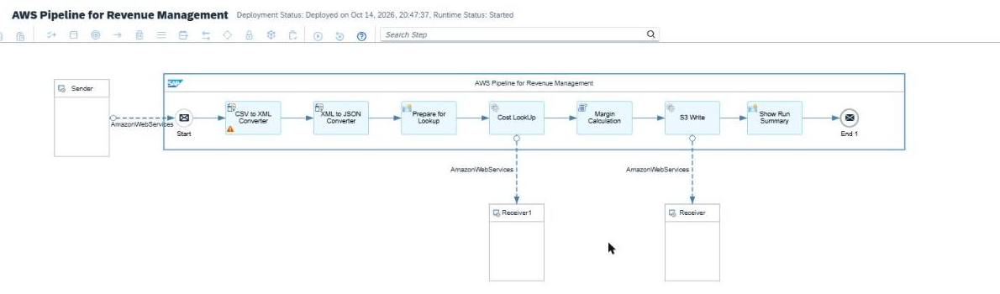

---

### Create a Package and an Integration Flow

#### Create an Integration Package

Now that we understand the integration scenario, it is time to create the integration flow (iFlow).

👉 Navigate to SAP Integration Suite - URL specified under System Access. Now, create a new Integration Package, name it ***AWS Pipeline for Revenue Management Integration Scenario User{{var:userNumber}}*** (replace the number with the number corresponding to your user) and select the **Save** button.

| Field | Value |
| ---------- | ------- |
| Name | AWS Pipeline for Revenue Management Integration Scenario User{{var:userNumber}} |
| Technical Name | AWSPipelineforRevenueManagementIntegrationScenarioUser{{var:userNumber}} |
| Short Description | This integration package contains artifacts part of the Developer Garage where we explore how to ingest and enrich sales data in Amazon S3 using the AmazonWebServices adapter. |

#### Create the Integration Flow

On the package's **Artifacts** tab, click **Add → Integration Flow → Add Integrations manually**. Select  Keep **Create** selected and fill in:

| Field | Value |
| :--- | :--- |
| Name | `AWS Pipeline for Revenue Management User{{var:userNumber}}` |
| ID | *(auto-populated)* |

Click **Add**, open the integration flow, and click **Edit**. Delete the default **Sender** and **Receiver**. This flow is started by a timer and has no sender.

> **Tip:** You add steps from the palette at the top of the canvas. Converters, Content Modifier, and Groovy Script are under **Message Transformers**; Request Reply is under **Call → External Call**; extra receivers are under **Participants**. Menu names can differ slightly between tenant versions.

Click **Save** regularly as you build.

### Check the Credentials Provisioned for You

The AWS adapters authenticate to Amazon S3 with two secure parameters. They have been created in your tenant, so you don't create them and you never see the AWS access key or secret.

Check that they exist. Go to **Monitor → Integrations and APIs → Security Material**. In the list, find two entries named `S3Key` and `S3Secret` with type **Secure Parameter**.

You enter these names in the **Access Key Alias** and **Secret Key Alias** fields of the AWS adapters. If either is missing, ask a Developer Advocate. Don't create them yourself.

> **Caution:** The names are case-sensitive: `S3Key` and `S3Secret`. The AWS adapters look the credentials up by these names; a mismatch makes the deployment fail. Never ask for, paste, or share the AWS keys in chat, slides, screenshots, or a shared file.

---

### Start the Flow and Read the Sales File

#### Start Timer

Enter Edit mode by selecting the **Edit** button on the top right corner. Replace the **Start** event with a **Timer Start** event. On its **Scheduler** tab, keep **Basic** selected and set **Enter As** to `Simple Schedule`, **Repeat** to `None`, and **Schedule** to `On Deployment`, so the flow runs once each time you deploy.

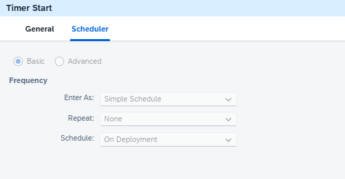

#### Read Sales File

Add a **Request Reply** after the timer and name it `Read Sales File`. Add a **Receiver** from the palette, connect **Read Sales File** to it, and choose adapter **AmazonWebServices** and message protocol **S3**.

Fill in the adapter settings:

| Tab | Field | Value |
| :--- | :--- | :--- |
| Connection | Host | `amazonaws.com` |
| Connection | Region Name | `eu-north-1 Europe (Stockholm)` (choose from the dropdown) |
| Connection | Bucket Name | `regional-landing-bkt` |
| Connection | Authentication Type | `Access and Secret Key` |
| Connection | Access Key Alias | `S3Key` |
| Connection | Secret Key Alias | `S3Secret` |
| Connection | Requester Pays | Unchecked |
| Connection | Enable Legacy Connectivity | Unchecked |
| Processing | Operation | `Read Operation` |
| Processing | Directory | `daily` |
| Processing | File Name | `sales_2026-10-14.csv` |
| Processing | Post-Processing | `Keep File` |
| Processing | Customer Decryption Key Alias | Leave empty |

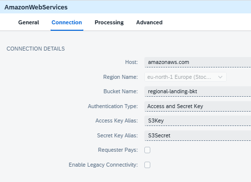

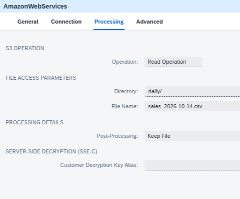

> **Caution:** Choose the region from the **Region Name** dropdown. A region label typed or pasted into a field makes the adapter fail with an `UnknownHostException`.

The file is never moved or deleted, so it stays in `daily/` and your flow can read it again each time you deploy.

### Convert the CSV to JSON

#### CSV to XML Converter

Add a **CSV to XML Converter** right after **Read Sales File**. On its **Processing** tab, click **Select** next to **XML Schema** and upload [`xml_schema.xsd`](https://raw.githubusercontent.com/sap-tutorials/integration/main/tutorials/dev-garage-aws-pipeline-revenue-management/files/xml_schema.xsd). If you don't have the file, save the XML below as `xml_schema.xsd` and upload that.

| Field | Value |
| :--- | :--- |
| XML Schema | `xml_schema.xsd` |
| Path to Target Element in XSD | `/Records/Row` |
| Record Marker in CSV | *(leave blank)* |
| Field Separator in CSV | `Comma` |
| Exclude First Line Header | ✓ |
| Configure CSV Headers to match | `XSD Elements` |

```xml
<?xml version="1.0" encoding="UTF-8"?>
<xs:schema xmlns:xs="http://www.w3.org/2001/XMLSchema">
  <xs:element name="Records">
    <xs:complexType>
      <xs:sequence>
        <xs:element name="Row" maxOccurs="unbounded">
          <xs:complexType>
            <xs:sequence>
              <xs:element name="transaction_id" type="xs:string"/>
              <xs:element name="store_id" type="xs:string"/>
              <xs:element name="region" type="xs:string"/>
              <xs:element name="product_id" type="xs:string"/>
              <xs:element name="product_name" type="xs:string"/>
              <xs:element name="category" type="xs:string"/>
              <xs:element name="quantity" type="xs:string"/>
              <xs:element name="unit_price" type="xs:string"/>
              <xs:element name="total_amount" type="xs:string"/>
              <xs:element name="sale_timestamp" type="xs:string"/>
              <xs:element name="payment_method" type="xs:string"/>
            </xs:sequence>
          </xs:complexType>
        </xs:element>
      </xs:sequence>
    </xs:complexType>
  </xs:element>
</xs:schema>
```

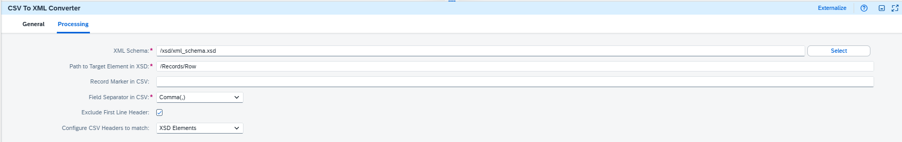

> The converter matches the CSV's header row against the XSD element names exactly, so the sales file's header must be lowercase: `transaction_id,store_id,region,product_id,product_name,category,quantity,unit_price,total_amount,sale_timestamp,payment_method`. The provided sales file already is.

#### XML to JSON Converter

Add an **XML to JSON Converter** after it:

| Field | Value |
| :--- | :--- |
| Use Namespace Mapping | *(unchecked; the XSD declares no namespace)* |
| Suppress JSON Root Element | *(unchecked; keeps the `{"Records":{"Row":[...]}}` shape the script expects)* |
| Other settings | *(defaults)* |

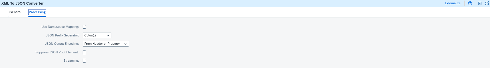

This converter writes every value as a JSON string. The Groovy script in Step 7 turns the numbers back into real numbers.

---

### Prepare for the Lookup

Add a **Content Modifier** after the XML to JSON Converter and name it `Prepare for Lookup`. On its **Exchange Property** tab, add four rows:

| Action | Name | Source Type | Source Value | Data Type |
| :--- | :--- | :--- | :--- | :--- |
| Create | `businessDate` | Expression | `${date:now:yyyy-MM-dd}` | |
| Create | `ingestedAt` | Expression | `${date:now:yyyy-MM-dd'T'HH:mm:ss'Z'}` | |
| Create | `sourceRegion` | Constant | `eu-north-1` | |
| Create | `preEnrichmentJson` | Expression | `${body}` | `java.lang.String` |

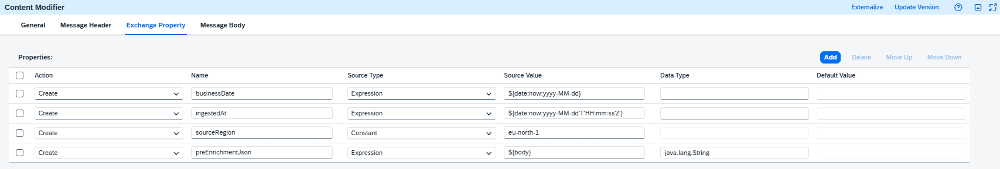

- `businessDate`, `ingestedAt`, and `sourceRegion` record when and where the file was ingested.
- `businessDate` also names the curated file (`sales_<businessDate>.json`). Running the flow twice on the same day overwrites that day's file.
- `preEnrichmentJson` sets the sales data aside, because the next step replaces the message body with the cost file.

> **Caution:** Set the Data Type of `preEnrichmentJson` to `java.lang.String`. Without it, the property only points at the body's data stream, the lookup in the next step reads that stream to the end, and the script later finds the property empty ("Text must not be null or empty").

---

### Look Up Unit Costs from S3

Unit costs live in a reference file that has been placed in S3: `regional-landing-bkt/reference/product_master.csv`. You read it mid-flow with the same AWS adapter, the same way as the sales file.

Add a **Request Reply** after Prepare for Lookup and name it `Cost LookUp`. Add a **Receiver** from the palette (its default name is `Receiver1`). Connect **Cost LookUp** to it and choose **AmazonWebServices**, protocol **S3**.

| Field | Value |
| :--- | :--- |
| Host | `amazonaws.com` |
| Region Name | `eu-north-1 Europe (Stockholm)` (choose from the dropdown) |
| Bucket Name | `regional-landing-bkt` |
| Authentication Type | `Access and Secret Key` |
| Access Key Alias | `S3Key` |
| Secret Key Alias | `S3Secret` |
| Operation | `Read Operation` |
| Directory | `reference` |
| File Name | `product_master.csv` |
| Post-Processing | `Keep File` |

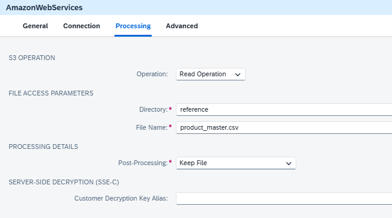

> **Caution:** Post-Processing defaults to **Delete File**. Change it to **Keep File**. With the default, the read fails, because you're only allowed to read the reference folder.

After this step, the message body is the cost file itself:

```text
product_id,unit_cost
P-1001,11.99
P-1002,23.99
P-1003,5.99
...
```

Read Sales File and Cost LookUp use the same adapter and the same operation. Only the file differs.

---

### Calculate Profit Margin

Add a **Groovy Script** step after Cost LookUp and name it `Margin Calculation`. Click the step's create-script icon, replace the template in the editor with the script below, and click **OK**.

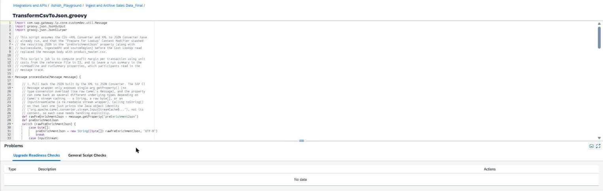

It's the only code in the flow. It:

- reads the sales data back out of `preEnrichmentJson`,
- builds a cost lookup from the CSV in the body,
- adds `unit_cost`, `gross_margin`, and `margin_percentage` to every sale,
- stores a run summary in the `runHeadline` and `runSummary` properties.

```groovy
import com.sap.gateway.ip.core.customdev.util.Message
import groovy.json.JsonOutput
import groovy.json.JsonSlurper

// This script assumes the CSV->XML Converter and XML to JSON Converter have
// already run, and that the "Prepare for Lookup" Content Modifier stashed
// the resulting JSON in the "preEnrichmentJson" property (along with
// businessDate, ingestedAt and sourceRegion) before the Cost LookUp read
// replaced the message body with product_master.csv.
//
// This script's job is to compute profit margin per transaction using unit
// costs from the reference file in S3, and to leave a run summary in the
// runHeadline and runSummary properties, which participants read in the
// message trace.

Message processData(Message message) {

    // 1. Pull back the JSON built by the XML to JSON Converter. The SAP CI
    // Message wrapper only exposes single-arg getProperty() (no
    // type-conversion overload like raw Camel's Message), and the property
    // can come back as several different underlying types depending on
    // Camel's stream caching -- a String, a raw byte[], or an
    // InputStreamCache (a re-readable stream wrapper). Calling toString()
    // on that last one just prints the Java object identity
    // ("org.apache.camel.converter.stream.InputStreamCache@..."), not its
    // content, so each case needs handling explicitly.
    def rawPreEnrichmentJson = message.getProperty("preEnrichmentJson")
    def preEnrichmentJson
    switch (rawPreEnrichmentJson) {
        case byte[]:
            preEnrichmentJson = new String((byte[]) rawPreEnrichmentJson, "UTF-8")
            break
        case InputStream:
            // The property can share one stream with the body. If a step in
            // between (such as the Cost LookUp read) has already read that
            // stream to the end, rewind it first, or getText() returns "".
            try { rawPreEnrichmentJson.reset() } catch (ignored) { }
            preEnrichmentJson = rawPreEnrichmentJson.getText("UTF-8")
            break
        default:
            preEnrichmentJson = rawPreEnrichmentJson as String
    }
    if (!preEnrichmentJson?.trim()) {
        throw new IllegalStateException("Property preEnrichmentJson is empty. In 'Prepare for Lookup', " +
            "set the Data Type of preEnrichmentJson to java.lang.String so it holds a copy of the sales JSON.")
    }
    def parsedPayload = new JsonSlurper().parseText(preEnrichmentJson)

    // 1a. The XML to JSON Converter mirrors the XML element names exactly,
    // so the rows live at Records.Row -- there is no flat "records" key.
    // Confirm this shape in your own Message Processing Log; if your
    // converter's settings ever produce something different, adjust this
    // line to match.
    def rawRows = parsedPayload.Records.Row
    // Guard against the single-record edge case: some XML->JSON conversions
    // collapse a lone repeating element into a single object instead of a
    // one-element array, which would otherwise break the .each{} below.
    def rows = rawRows instanceof List ? rawRows : [rawRows]

    // 1b. Attach the ingestion metadata from the properties set in
    // "Prepare for Lookup". This also reshapes the payload into the flat
    // { "source-region", "ingested-at", "records" } structure used
    // everywhere else in this lab, instead of the nested Records.Row shape
    // that only exists because that's how the XML happened to be structured.
    def payload = [
        "source-region": message.getProperty("sourceRegion"),
        "ingested-at"  : message.getProperty("ingestedAt"),
        "records"      : rows
    ]

    // 2. Parse the reference file read from S3 by Cost LookUp (the current
    // body): regional-landing-bkt/reference/product_master.csv, with a
    // header line "product_id,unit_cost" followed by one product per line.
    // The header line is skipped, which also skips any byte-order mark a
    // spreadsheet tool may add. Splitting on comma or semicolon covers Excel
    // on European locales, which saves CSVs with semicolons.
    def costLookup = [:]
    message.getBody(java.io.Reader).readLines().drop(1).findAll { it.trim() }.each { line ->
        def cols = line.split(/[,;]/)
        costLookup[cols[0].trim()] = new BigDecimal(cols[1].trim())
    }

    // 3. The one genuinely custom piece of business logic left in code:
    // derive profit margin, a number that doesn't exist anywhere in the
    // source CSV, from cost data that only lives in the reference file.
    payload.records.each { record ->
        def unitCost = costLookup[record.product_id]
        def quantity = record.quantity as BigDecimal
        def totalAmount = record.total_amount as BigDecimal
        def unitPrice = record.unit_price as BigDecimal

        // Write the numeric casts back onto the record. The XML to JSON
        // Converter serializes every XML text node as a JSON string, so
        // without this quantity/unit_price/total_amount would stay quoted
        // in the curated output.
        record.quantity = quantity
        record.unit_price = unitPrice
        record.total_amount = totalAmount

        if (unitCost != null) {
            def cost = unitCost * quantity
            def margin = totalAmount - cost
            record.unit_cost = unitCost
            record.gross_margin = margin.setScale(2, BigDecimal.ROUND_HALF_UP)
            record.margin_percentage = totalAmount == 0 ? 0 :
                (margin / totalAmount * 100).setScale(1, BigDecimal.ROUND_HALF_UP)
        } else {
            record.unit_cost = "unknown"
            record.gross_margin = "unknown"
            record.margin_percentage = "unknown"
        }
    }

    // 4. Build a short run summary. Nothing here changes the curated JSON --
    // it only sets two exchange properties, runHeadline and runSummary,
    // which show up in Monitor -> the message's trace -> Properties for any
    // step after this one. Edit the two path constants if your buckets differ.
    // Read Sales File keeps the source file in place (Post-Processing: Keep
    // File), so it stays in daily/ for the next run.
    def sourcePath  = "regional-landing-bkt/daily/ (kept for the next run)"
    def curatedPath = "curated-corp/profit-margins/sales_" + message.getProperty("businessDate") + ".json"

    def priced = payload.records.findAll { it.gross_margin instanceof Number }
    def unpricedCount = payload.records.size() - priced.size()
    def totalRevenue = priced.sum(BigDecimal.ZERO) { it.total_amount as BigDecimal }
    def totalMargin  = priced.sum(BigDecimal.ZERO) { it.gross_margin as BigDecimal }
    def marginPct = totalRevenue == 0 ? BigDecimal.ZERO :
        (totalMargin / totalRevenue * 100).setScale(1, BigDecimal.ROUND_HALF_UP)

    def marginBy = { String field ->
        priced.groupBy { it[field] }.collectEntries { key, recs ->
            [key, recs.sum(BigDecimal.ZERO) { it.gross_margin as BigDecimal }]
        }
    }
    def topProduct = priced ? marginBy("product_name").max { it.value } : null
    def topRegion  = priced ? marginBy("region").max { it.value } : null

    // Locale.US pins the format to 1,234.56 regardless of the tenant JVM's
    // default locale (which could otherwise render 1.234,56).
    def money = { BigDecimal v -> "\$" + String.format(Locale.US, "%,.2f", v) }

    def lines = []
    lines << "Profit margin run complete"
    lines << ""
    lines << "Business date:  " + message.getProperty("businessDate")
    lines << "Records:        " + payload.records.size() + " (" + unpricedCount + " without cost data)"
    lines << "Revenue:        " + money(totalRevenue)
    lines << "Gross margin:   " + money(totalMargin) + " (" + marginPct + "%)"
    if (topProduct) {
        lines << ""
        lines << "Top product:    " + topProduct.key + " (" + money(topProduct.value) + " margin)"
        lines << "Top region:     " + topRegion.key + " (" + money(topRegion.value) + " margin)"
    }
    lines << ""
    lines << "Read from:      " + sourcePath
    lines << "Published to:   " + curatedPath

    message.setProperty("runHeadline",
        "Profit margins ready: " + message.getProperty("businessDate") + " | " + marginPct + "% gross margin")
    message.setProperty("runSummary", lines.join("\n"))

    message.setBody(JsonOutput.toJson(payload))
    message.setHeader("Content-Type", "application/json")
    return message
}
```

> The **Read from** and **Published to** lines in the summary use fixed paths. If your folders differ from the defaults, edit the `sourcePath` and `curatedPath` lines in the script. The flow itself doesn't depend on them.

### Write the Curated File and Show the Summary

#### S3 Write

Add a **Request Reply** after Margin Calculation and name it `S3 Write`. Add a third **Receiver** from the palette, connect **S3 Write** to it, and choose **AmazonWebServices**, protocol **S3**.

| Field | Value |
| :--- | :--- |
| Host | `amazonaws.com` |
| Region Name | `us-west-1 US West (N. California)` (choose from the dropdown) |
| Bucket Name | `curated-corp` |
| Authentication Type | `Access and Secret Key` |
| Access Key Alias | `S3Key` |
| Secret Key Alias | `S3Secret` |
| Operation | `Write Operation` |
| Directory | `profit-margins` |
| File Name | `sales_${property.businessDate}.json` |
| Content Type | `application/json` |
| Existing File Handling | `Overwrite` |

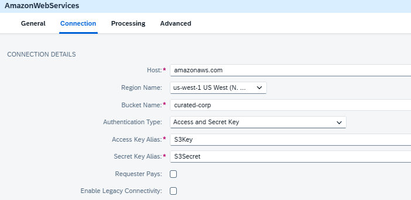

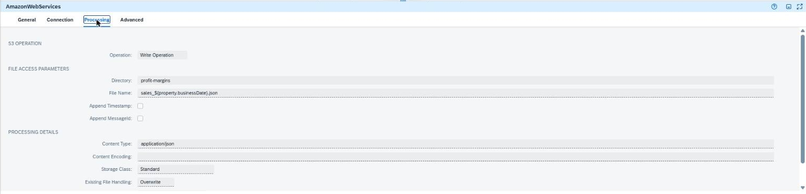

#### Show Run Summary

Add a **Content Modifier** after S3 Write, name it `Show Run Summary`, and connect it to the **End** event:

| Tab | Setting | Value |
| :--- | :--- | :--- |
| Message Body | Type | `Expression` |
| Message Body | Body | `${property.runSummary}` |
| Message Header | `Content-Type` | Constant: `text/plain` |

After the S3 write, the body is only S3's acknowledgement. This step puts the run summary there instead, so the last thing you see in the Monitor is the result of the whole run.

Your finished flow:


---

### Deploy and Test

Click **Save**, then **Deploy**. Go to **Monitor → Integrations and APIs → Manage Integration Content** and wait until your integration flow shows **Started**.

In the same view, select your integration flow and set its **Log Level** to **Trace**. Trace switches itself off after a short while, so do this right before testing.

> 🚨 Your iFlow runs once each time you deploy it. ***You will need to redeploy it after updating the trace level.***

Open **Monitor Message Processing** and wait for your message to show **Completed**. Open it, select the **Trace** link in the ***Logs*** section.

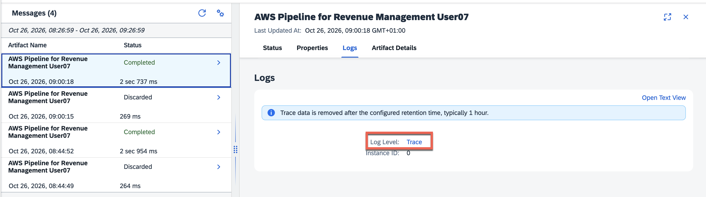

The view shows the message *before* the step you select.

| Check | Where | What you should see |
| :--- | :--- | :--- |
| Picked up | Monitor Message Processing | Your message appears. The file stays in `daily/` |
| Enriched | **S3 Write** → Payload | Every sale has `unit_cost`, `gross_margin`, and `margin_percentage` |
| Summarized | **End 1** → Exchange Properties | `runSummary` holds the run summary |

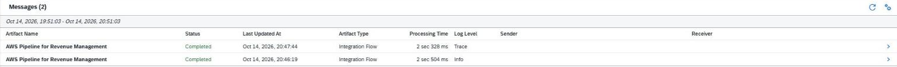

Now, select the last Run Step, e.g. ***End 1***, choose the **Message Content** tab and then the **Exchange Properties** tab. 

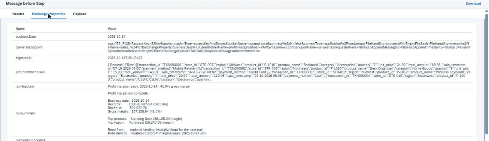

This example comes from a test run with the 1,000-row sample file `sales_2026-10-14.csv`:

```text
Profit margin run complete

Business date:  2026-10-14
Records:        1000 (0 without cost data)
Revenue:        $91,022.76
Gross margin:   $37,338.94 (41.0%)

Top product:    Standing Desk ($6,125.00 margin)
Top region:     Northeast ($9,240.39 margin)

Read from:      regional-landing-bkt/daily/ (kept for the next run)
Published to:   curated-corp/profit-margins/sales_<today's date>.json
```

> Every run processes the same 1,000-row file, so your numbers match the example. **Records** should equal the number of rows in the file, and **0 without cost data** confirms every product was found in the reference file.

#### Troubleshooting

| Issue | Fix |
| :--- | :--- |
| `UnknownHostException: s3.Europe (Stockholm)...` | The region was entered as a label instead of chosen from the dropdown. Select `eu-north-1 Europe (Stockholm)`. |
| Deployment fails mentioning a credential | The names in the Access Key Alias and Secret Key Alias fields of all three AWS adapters must be exactly `S3Key` and `S3Secret`. If they are, check Step 3 for both entries; if one is missing, ask a Developer Advocate. |
| `Header TRANSACTION_ID not present in CSV headers` | The sales file's header doesn't match the XSD. It must be the lowercase header shown in Step 5. |
| Cost LookUp: access denied | Post-Processing must be **Keep File**, not Delete File. If it is, ask a Developer Advocate to check the reference folder permission. |
| Cost LookUp: file not found | Directory must be `reference` and File Name `product_master.csv`, exactly, in Region `eu-north-1`. |
| `Text must not be null or empty` (Margin Calculation) | The stashed sales data is empty. Set the Data Type of `preEnrichmentJson` to `java.lang.String` in Prepare for Lookup. |
| `JsonException ... current character read is '<'` | The stashed property holds XML. The XML to JSON Converter is missing, or Prepare for Lookup sits before it. |
| Every record shows `unit_cost` "unknown" | The lookup found no costs. Check in Message Content that the body after Cost LookUp starts with `product_id,unit_cost`. |
| Curated file is named `sales_.json` | `businessDate` is missing. Add it in Prepare for Lookup (Step 6). |
| Script check: JSONSlurper without streaming | A best-practice warning, not an error. The script already reads the body as a stream. |
| No Message Content in the Monitor | Trace wasn't active when the file was processed. Set the log level to Trace and deploy again. |
| My message never appears | Check your flow is **Started** in Manage Integration Content, and that the Directory in Read Sales File is `daily`. |

#### References

- [Amazon Web Services Adapter Guide for SAP Cloud Integration](https://hub.sap.com/odata/1.0/catalog.svc/Files('10541079cd834d69a3fbd978c85b11bd')/$value)
- [Amazon Web Services Adapter for SAP Cloud Integration (SAP Community)](https://blogs.sap.com/2021/02/17/amazon-web-services-adapter-for-sap-cloud-integration/)
