# SAP TechEd Developer Garage: React to unstructured Customer Requests with Cloud Integration and AI Core

<!-- description --> We will receive customer request events from a customer website, process them in SAP Cloud Integration with the help of an LLM hosted in SAP AI Core. Then, that information will be sent to the Customer service request system, which is a CAP service built for the tutorial.

## Overview

Let's imagine we work for a company, Altura Coffee Co. The company sells high-end coffee machines for businesses, e.g. commercial espresso machines for cafes and restaurants, as well as industrial coffee machines perfect for large offices, designed to meet the coffee demands of a busy workforce. Altura Coffee Co. also provides maintenance and customer support for the coffee machines that they sell.

Traditionally, customer requests have been sent to an email address, which is monitored by the support team and processed manually. Now, Altura Coffee Co. receives customer support requests via a form on their website. We oversee enabling the integration scenario that will process these requests (events), extract the relevant information (e.g., customer details, machine information, severity of the request, etc.). Our process moves from manual handling to an AI-enabled integration that reacts in real-time.

We will receive customer request events from a customer website, process them in SAP Cloud Integration with the help of an LLM hosted in SAP AI Core. Then, that information will be sent to the Customer service request system, which is a CAP service built for the tutorial.

## You will learn

- How to configure an integration flow to react to events published in a particular topic.
- How to interact with an existing orchestration configuration available in SAP AI Core
- Use an LLM to process unstructured customer requests and convert them to structured data

## Prerequisites

- Contact a Developer Advocate in the Developer Garage to share the necessary credentials for accessing the provisioned systems.
- Various systems have been provisioned for you to complete this tutorial.

---

### System access

As part of this tutorial, you will need to access the provisioned systems using the credentials shared with you. In the table below, you will find the necessary information to access each system.

> There are two SAP Integration Suite environments available for use in this tutorial. Use the one corresponding to your user range.

| System | URL |
| --- | --- |
| Altura Coffee Co. website | https://url.sap/s54i3n |
| SAP Integration Suite - Dev Garage 1 (User01 - User99) | <https://url.sap/054nme> |
| SAP Integration Suite - Dev Garage 2 (User100 - User180) | <https://url.sap/i18ebv> |
| Altura Customer Requests Service | https://url.sap/kq6qnd |

Before we start building our integration scenario, it is important to get familiar with the systems and websites we will be interacting with during the tutorial. We will explore two auxiliary applications: the Altura Coffee Co. company website, through which customers submit support requests, and the customer service system where processed requests will eventually appear.

Important so we get an understanding of how a customer submits a support request, what data is captured in the form, and what the target customer service system looks like.

### The Altura Coffee Co. website

Altura Coffee Co. sells high-end coffee machines for businesses. Customers who experience issues with their equipment, or who need supplies, submit requests via a form on the company website.

👉 Navigate to the Altura Coffee Co. website - URL shared in Step 1.

Take a moment to explore the website. Notice that there is a **Request Support** button on the top right corner. This will take you to the *Submit a support request form*, which is the form through which customers send their support requests.

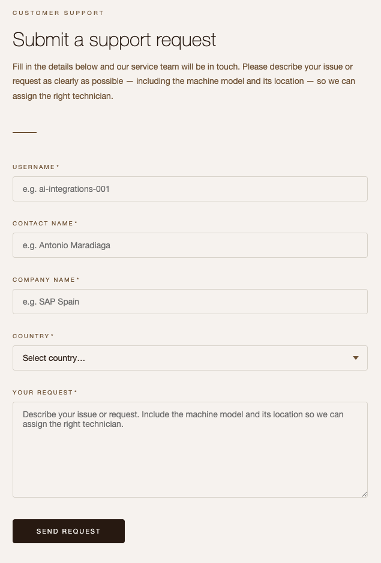

> The form is designed to capture free-text input, meaning the customer can describe their issue in their own words. This is exactly the kind of unstructured input that our integration scenario process by leveraging an LLM.

👉 Read through a sample support request to understand the kind of content the form captures. Below is an example of the type of message a customer might submit:

```
Hi customer support from Altura,

We have a La Marzocco Micra in the Plaza Pablo Picasso office in Madrid 28020, which is not extracting coffee as it should. Can you please send a technician to check the machine.

Also, we are running out of filters for the MoccaMaster that we have in the Castellana 85 office. Can you please send us a couple of boxes so that we have plenty of filters.

Thank you,
User{{var:userNumber}}
```

Notice how the message includes:

- One or more pieces of **equipment** that need attention
- **Addresses** where the equipment is located
- A description of the **issue or request**
- A **contact name**

These are all pieces of data that our integration flow will need to extract and structure. This is why we will use an LLM in our iFlow - to make sense of unstructured text like this.

> It is likely that you will try submitting a support request through the form using your username but it will not work because you haven't created the integration flow to process it :-). Instead, specify `User00` as there is an integration flow processing events for this user.

### The Altura Customer Requests Service

Once a request has been processed by our integration flow, the structured data will be sent to a customer service system. This is where the support team will be able to see all incoming requests and act on them.

👉 Navigate to the Altura Customer Requests Service - URL shared in Step 1. Choose one of the listed requests to familiarise yourself with a customer request.

At the moment, you might see some existing requests already in the system (submitted to demonstrate the expected end state). Take note of the data fields visible in each request - we will be populating these fields from our integration flow later in the tutorial.

> 🧭 The customer service system exposes its data via a REST API. We will interact with it from the integration flow

### SAP AI Core and generative AI capabilities

[SAP AI Core](https://help.sap.com/docs/sap-ai-core) is a service on SAP BTP that provides infrastructure to train and serve AI models. As part of its generative AI capabilities, SAP AI Core includes the [Generative AI Hub](https://help.sap.com/docs/sap-ai-core/sap-ai-core-service-guide/generative-ai-hub-in-sap-ai-core), which gives you access to foundation models (LLMs) from multiple providers, such as OpenAI, Google, and Anthropic, through a unified interface.

The Generative AI Hub also allows you to create and manage **prompt templates** — reusable prompt structures that can be invoked consistently across different scenarios. This is particularly useful in integration contexts, where the same prompt logic needs to be applied to many different input messages.

The prompt template used in this tutorial instructs the LLM to act as a customer support assistant at Altura Coffee Co. Its job is to detect and classify any issues related to coffee machines mentioned in a customer message, extract address information, and assess the urgency of the request.

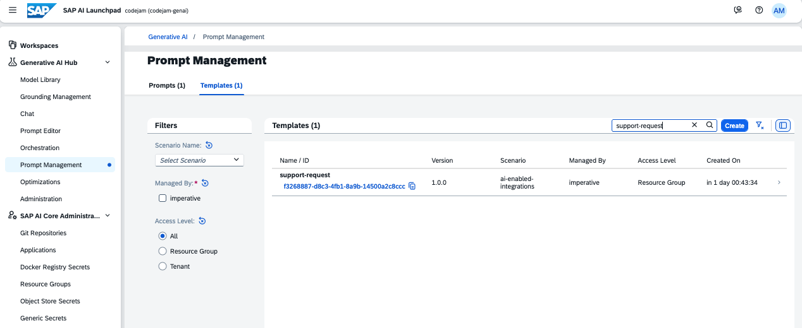

The prompt template instructs the model to:

1. Detect any issues related to coffee machines mentioned in the text
2. Extract all addresses mentioned (including the customer's sender address, if present)
3. Classify each address by its relevance to the request (from 1 to 10)
4. Summarise the overall request in a single sentence
5. Assess the urgency of the request (Low, Medium, or High)

The model is instructed to respond **only** with a JSON structure matching the following schema:

```json
{
  "tasks": [
    {
      "equipment": [
        "Namelmodel of coffee machine 1",
        "Name/model of coffee machine 2"
      ],
      "address": "extracted address here",
      "country": "extracted country here",
      "postal_code": "extracted postal code here",
      "relevance": 1
    },
    {
      "equipment": [
        "Namelmodel of coffee machine 1",
        "Namelmodel of coffee machine 2"
      ],
      "address": "extracted address here",
      "country": "extracted country here",
      "postal_code": "extracted postal code here",
      "relevance": 10
    }
  ],
  "relevance": 1,
  "request_original": "original unstructured customer support request here",
  "request_summary": "Summary of the request",
  "urgency": "Low/Medium/High"
}
```

#### Orchestration

The orchestration service runs on SAP AI Core under the global AI scenario orchestration. It provides unified access to multiple generative AI models through consistent code, configuration, and deployment. Most importantly, it provides a harmonized API that allows you to use different foundation models without changing the client code.

Key features of orchestration include:

- Templating: This feature lets you compose prompts with placeholders that are populated during inference.
- Content filtering: This feature allows you to restrict the type of content passed to and received from generative AI models.
- Data masking: This feature enables anonymization or pseudonymization of data before passing it to a generative AI model. With pseudonymization, masked data in the model's response is automatically restored.
- Grounding: This feature lets you integrate external, domain-specific, or real-time data to enhance pretrained models with contextually relevant information beyond their general training material.
- Translation: This feature lets you add translation capabilities for both input and output in your orchestration workflow.

An orchestration workflow has been preconfigured to define the prompt template and the model to be used when processing customer support requests. The workflow is very simple as we only use the prompt template and a model, but it is possible to add additional steps to the workflow, e.g. to add grounding or translation steps. Having an orchestration workflow we separate the orchestration logic from the integration logic, making it easier to manage and update each independently. The orchestration logic lives in SAP AI Core and our integration logic in the iFlow within SAP Integration Suite. We can version the orchestration workflow independently which allows us to make changes without affecting the integration. Also, it is a reusable component meaning that different AI applications/workflows can leverage the same orchestration object.

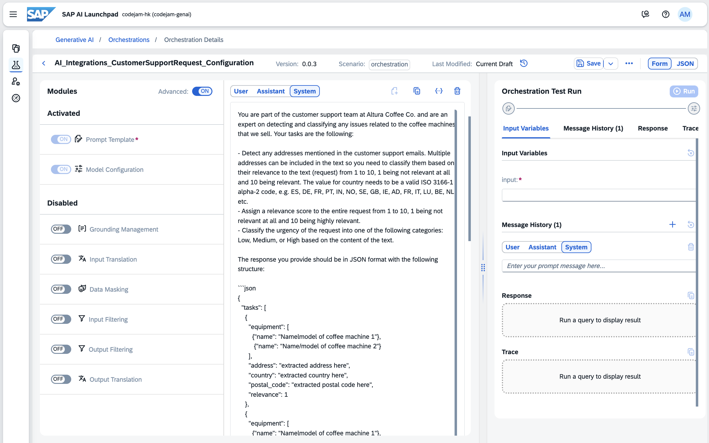

In our iFlow, we will set the Orchestration configuration details as exchange properties that will be used by a Groovy script when preparing the request before calling the Orchestration configuration in AI Core.

### Create an Integration Package

Now that we understand the integration scenario and what our prompt template produces, it is time to create the integration flow (iFlow) that will process incoming customer support requests.

👉 Navigate to SAP Integration Suite - URL shared in Step 1. Now, create a new Integration Package, name it *CustomerRequest Integration Scenario User{{var:userNumber}}* (replace the number with the number corresponding to your user) and select the **Save** button.

| Field | Value |
| ---------- | ------- |
| Name | CustomerRequest Integration Scenario User{{var:userNumber}} |
| Technical Name | CustomerRequestIntegrationScenarioUser{{var:userNumber}} |
| Short Description | This integration package contains artifacts part of the Developer Garage where we explore use an LLM to process unstructured data. |

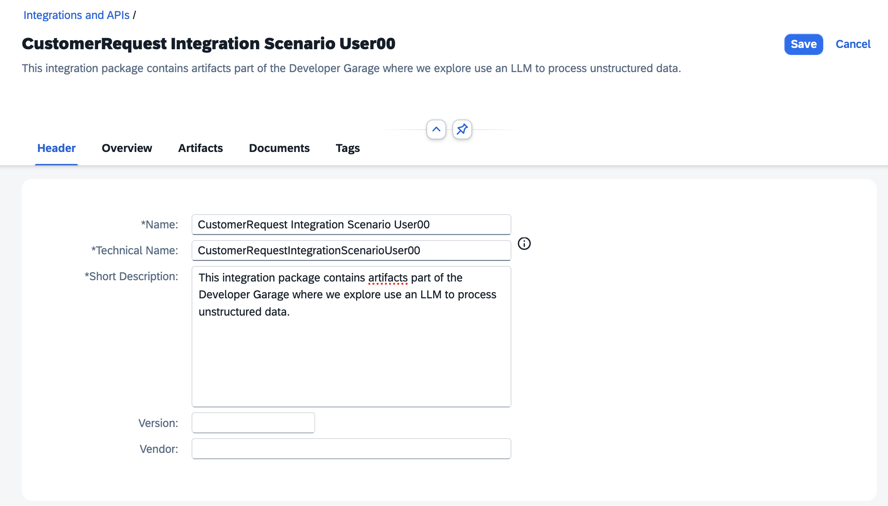

> Unfortunately, we might not have enough time to create an integration flow from scratch. Therefore, we've prepared an integration flow for you to copy and configure to speed up the creation process.

👉 Now, navigate to the **CustomerRequest Integration Scenario User00** integration package, select the actions button **...** of the **AEM_WebsiteCustomerRequest_AICore_Processor_User00** integration flow and then the **Copy** button to copy the integration flow.

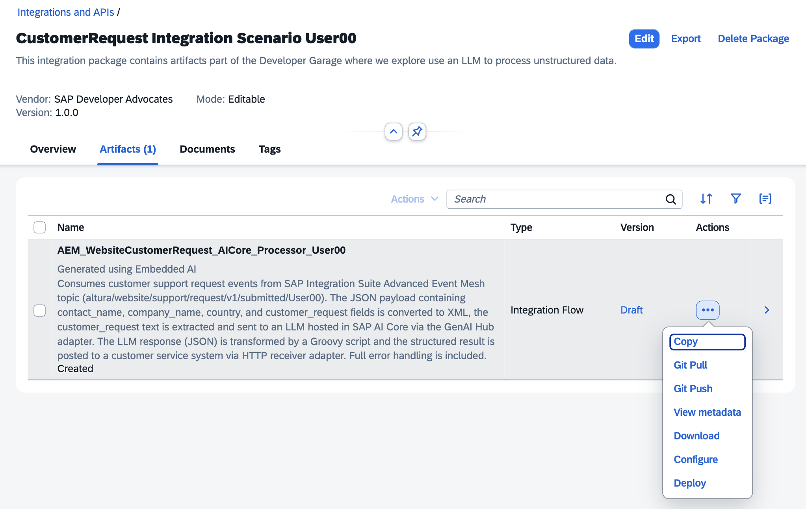

👉 In the pop-up, set your username as the name of the Integration Flow and select the Integration package you created previously.

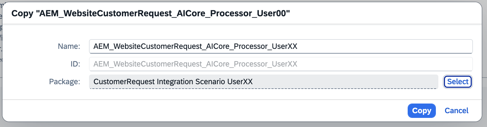

Our copied integration flow is ready for us. Let's get familiar with it.

### Configure the Integration Flow

👉 Navigate to the newly copied integration flow (**AEM_WebsiteCustomerRequest_AICore_Processor_User{{var:userNumber}}**) and open it.

👉 Select the Configure button in the top right corner of the integration flow editor. A pop-up will appear where you can configure the values below:

| Field | Value |
|-------|-------|
| **Sender Tab** | -- |
| Value | Replace the placeholder `User{{var:userNumber}}` with your actual user number, e.g. User85 |
| **Receiver Tab** | --- |
| AICoreDeployymentID | Users User01-User99, set `dbd716fe17616cc3` as the value. Users User100-User180, set `d6bc04de07fb1d32` as the value. |
| **More Tab** | --- |
| AI-Resource-Group | Set `default` as the value |

👉 Once the values are configured, select the **Save** button to apply the changes and then dismiss the pop-ups by choosing the **Close** button.

Now, lets get familiar with each step in the integration flow.

### AdvancedEventMesh sender adapter

The iFlow will be kicked off by the AEM adapter step, but it will need to be configured with the correct connection details for the AEM instance that has been provided for the tutorial.

👉 Choose the AEM adapter step in the iFlow and get familiar with its properties, e.g. Host, Message VPN, Authentication Type. In the **Processing** tab, the Consumer Mode, Topic subscription.

> In the Processing tab, we'll see the updated Topic Subscriptions field as we replaced `User{{var:userNumber}}` with the actual user number.

#### Store original payload - Content Modifier

In the Content Modifier, the **Exchange Property** tab should be used to store the original payload. Check the below properties match.

| Action | Name | Source Type | Source Value | Data Type | Default Value |
|--------|------|-------------|--------------|-----------|---------------|
| Create | originalBody | Expression | ${in.body} | java.lang.String |  |

#### JSON to XML Converter

In the **Processing** tab, the following properties are set. We are just converting our payload to further process it.

| Property | Value |
|----------|-------|
| Use namespace mapping | ✅ |
| Add XML root element | ✅ |

#### Customer Request and LLM properties - Content Modifier

Here we will be preparing for the request to SAP AI Core and most of the configuration is set here. The following properties have been set

- **Message Header** tab
  
    | Action | Name | Source Type | Source Value | Data Type | Default Value |
    |--------|------|-------------|--------------|-----------|---------------|
    | Create | Content-Type | Constant | `application/json` |  |  |
    | Create | AI-Resource-Group | Constant | `default` |  |  |

- **Exhange Property** tab

    | Action | Name | Source Type | Source Value | Data Type | Default Value |
    |--------|------|-------------|--------------|-----------|---------------|
    | Create | AICoreOrchestrationVersion | Constant | `0.0.3` |  |  |
    | Create | AICoreOrchestrationName | Constant | `AI_Integrations_CustomerSupportRequest_Configuration` |  |  |
    | Create | AICoreOrchestrationScenario | Constant | orchestration |  |  |
    | Create | customer_request | XPath | `/root/data/customer_request` | `java.lang.String` |  |

#### Prepare LLM Request - Groovy script

When interacting with the SAP AI Core API, we need to send a JSON payload with a specific structure. We will use a Groovy script to prepare this payload. The script does the following:

- Trim the customer request so that is set properly in the JSON payload.
- Sets the values configured in the previous Content Modifier.
- Log the to be sent payload for debugging purposes.

👉 Check the contents of **PrepareLLMRequest.groovy** in the Groovy script step.

Below we can see how the Groovy script is displayed in the iFlow editor. Notice that it uses the ***Groovy Flowstep version 2.x***.

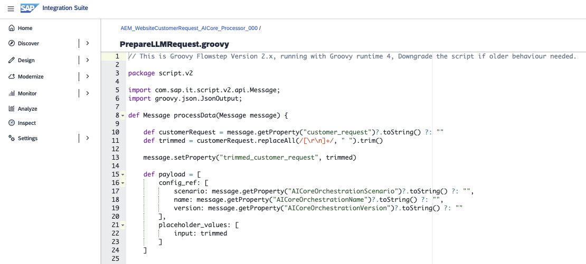

#### AICore - HTTP receiver adapter

The iFlow will call AI Core API directly and for that we will use the HTTP adapter. The following values have been configured

- **Connection** tab
  
  | Property | Value |
    |----------|-------|
    | Address | [aicore-api-url]/v2/inference/deployments/[deployment-id]/v2/completion |
    | Proxy Type | Internet |
    | Method | POST |
    | Authentication Type | OAuth2 Client Credentials |
    | Request Headers | `traceparent|AI-Resource-Group|Accept|Content-Type` |

> We'll see the updated deployment ID as we replaced `d6----` with the actual deployment ID.

#### Transform LLM JSON Response - Groovy script

The SAP AI Core API response needs to be transformed into a payload that matches what the Customer Request Service system API expect. We will use a Groovy script to prepare this payload. The script does the following:

- Extracts the `response` from the LLM (a JSON payload), which is within the nested structure and converts it from a string to a JSON object.
- Merges the original payload with the LLM response to create a new JSON payload. Also, do some clean up of the target payload.
- Log the final payload for debugging purposes.

👉 Check out the contents of **TransformLLMResponse.groovy** and see what the Groovy script does.

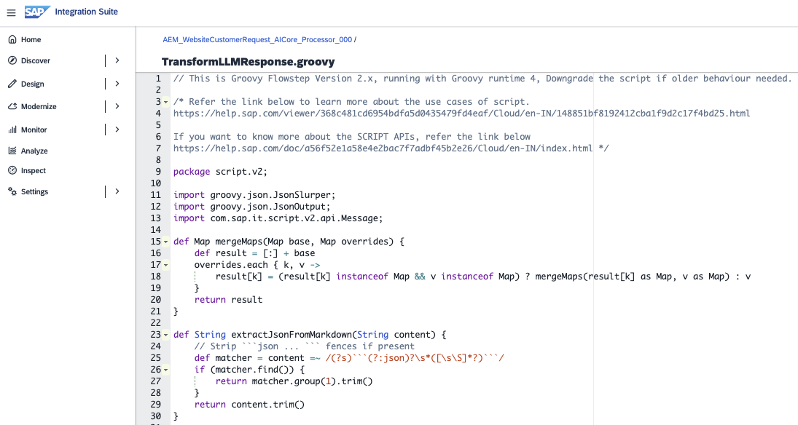

#### Altura_CustomerService_API - HTTP receiver adapter

Now that our payload is in the correct format, we can send it to the Altura Customer Requests Service system API.

Check that the following values have been set for the adapter:

- Connection tab
  
    | Property | Value |
    |----------|-------|
    | Address | [alturacs-api-url]/customer-requests/CustomerRequests |
    | Proxy Type | Internet |
    | Method | POST |
    | Authentication | None |

### Deploy and test the iFlow

👉 **Save** and **Deploy** the iFlow by choosing the button in the top right corner.

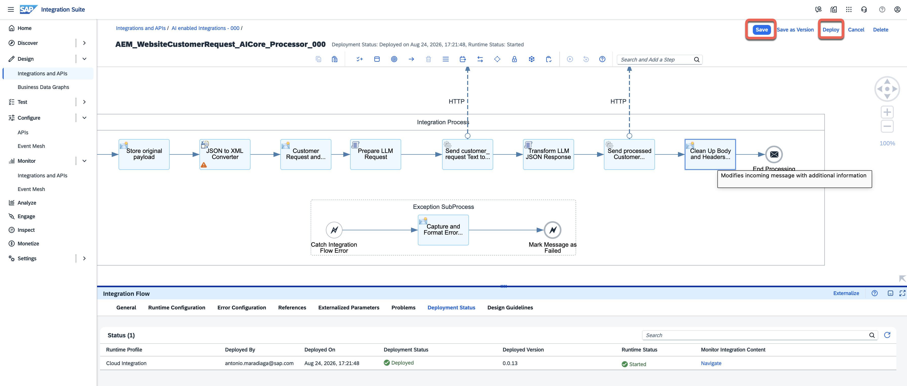

> [!NOTE]
> In the Deploy pop-up dialog, a single option will be available given that we have a single runtime available to us. If we had an Edge Integration Cell runtime configured in our tenant it will also be listed as an option.

Once deployed, navigate to **Monitor > Integrations and APIs**. Select the **Cloud Integration** runtime > **Manage Integration Content - All** to verify that the deployment was successful.

👉 Go to the [Altura's Coffee website](${credentialsObj.alturawebsite.url}) to send a customer request. Use the sample request from Exercise 00:

| Field | Value |
|-------|-------|
| Username | User{{var:userNumber}} (*Replace with your actual username*) |
| Contact Name | John Smith User{{var:userNumber}} |
| Contact Email | user{{var:userNumber}}@example.com |
| Country | Select your country, e.g. Spain |
| Request | Text below |


```text
Hi customer support from Altura,

We have a La Marzocco Micra in the Plaza Pablo Picasso office in Madrid 28020, which is not extracting coffee as it should. Can you please send a technician to check the machine.

Also, we are running out of filters for the MoccaMaster that we have in the Castellana 85 office. Can you please send us a couple of boxes so that we have plenty of filters.

Thank you,
John Smith User{{var:userNumber}}
```

👉 Check the Altura Customer Requests Service (*URL shared in Step 1*) to see if a new entry has appeared with the structured request data.

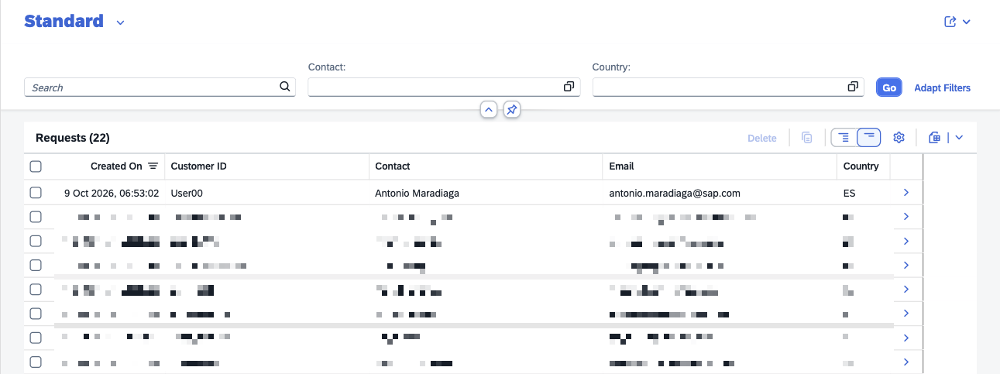

#### AI-assisted error resolution

If the request fails, check the **Monitor > Integrations and APIs**. Select the **Cloud Integration** runtime > **All Artifacts** in SAP Integration Suite and inspect the message processing log for your iFlow. This will show you exactly where the failure occurred.

Here we can leverage the [**AI-assisted error resolution** feature](https://help.sap.com/docs/integration-suite/isuite-integrations-and-apis/ai-assisted-error-resolution?locale=en-US) in SAP Integration Suite. This feature uses AI to analyze the error and provide suggestions for resolving it.

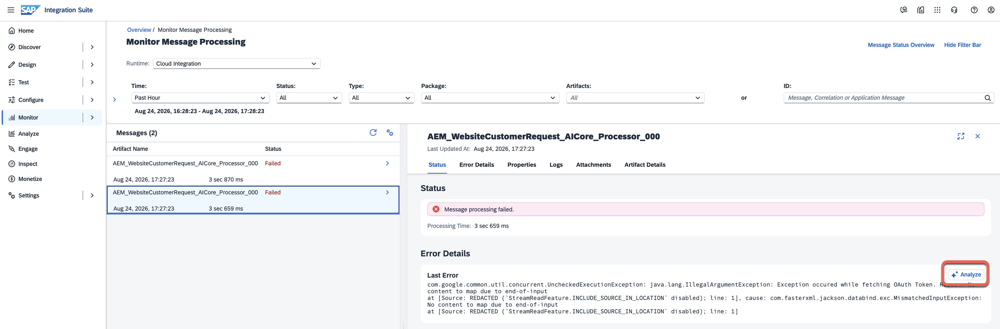

> [!NOTE]
> The AI-assisted error resolution feature will not be visible unless an error occurs during message processing.

### Summary

In this tutorial, we have walked through the process of creating an iFlow to handle unstructured data from customer requests received via the Altura's Coffee website. We covered the following steps:

1. Configure the Advanced Event Mesh adapter to listen for incoming customer requests.
2. Get familiar with the Groovy script responsible of preparing the request for the LLM.
3. Process the response via another Groovy script to extract the structured data and prepare the request for the Altura Customer Requests Service.
4. Verify that the structured request data has been successfully recorded in the Altura Customer Requests Service.
