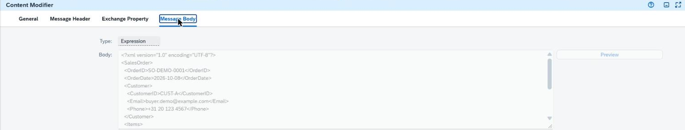
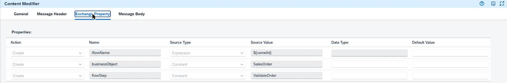
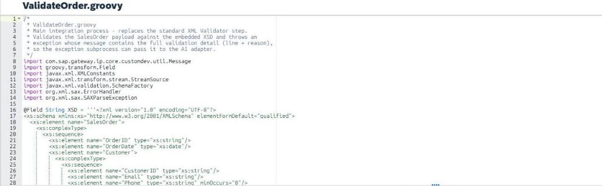
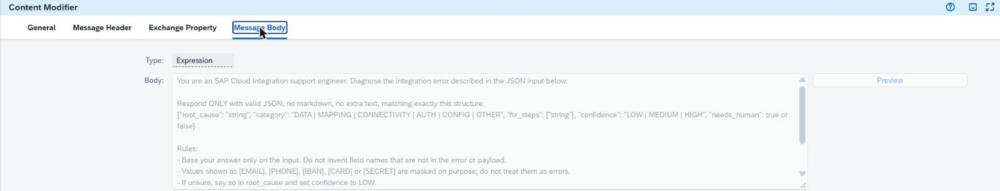
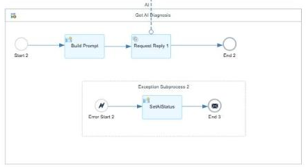
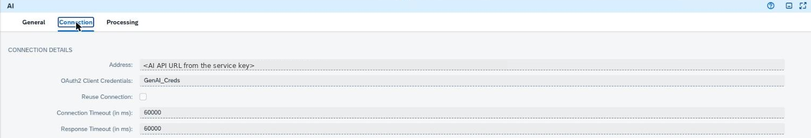
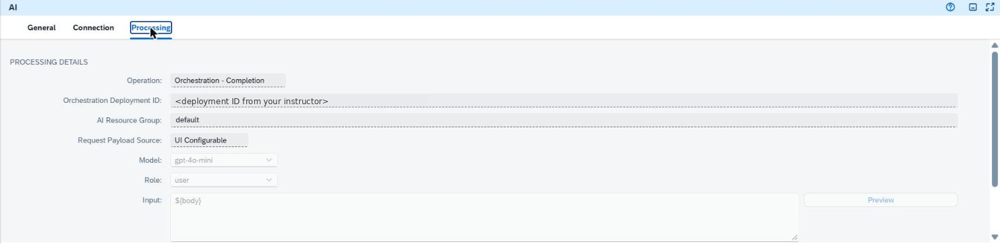
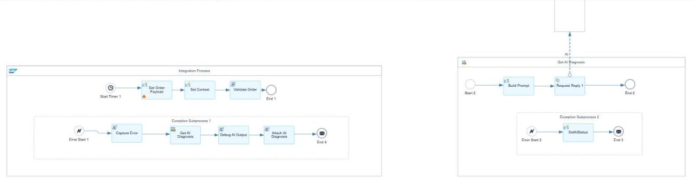
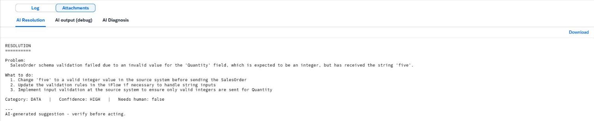
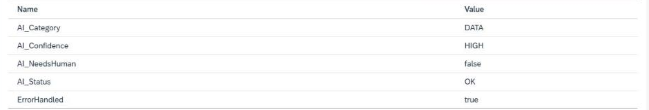

# SAP TechEd Developer Garage: Error Resolution with AI Adapter

<!-- description --> Build an integration flow in SAP Integration Suite that catches an error, masks it, asks an LLM in SAP AI Core for a diagnosis through the AI Adapter, and attaches a readable resolution to the message.

## Prerequisites

- An SAP BTP account with **SAP Integration Suite** and the **Cloud Integration** capability activated, and the **AI Adapter** available on your tenant
- [Assign roles to your user for Cloud Integration](https://help.sap.com/docs/integration-suite/sap-integration-suite/configuring-user-access?locale=en-US&state=PRODUCTION&version=CLOUD#loio2c6214a3228e4b4cba207f49fda92ed4__section_xbf_glz_l2c), including the `Integration_Developer` role collection
- The file `From the Instructor.txt`, which your instructor shares with you through a secure medium. It is not part of this repository. It contains the values from an **SAP AI Core** service key and deployment: `address`, `orchestration deployment id`, `ai resource group`, `model`, `token service url`, `clientid`, and `clientsecret`
- Familiarity with the SAP Integration Suite interface helps. No Groovy experience is required; all scripts are provided.

You don't need your own SAP AI Core instance. Your instructor prepares it. Generative AI Hub and orchestration need the **extended** SAP AI Core service plan.

## You will learn

- How to connect Cloud Integration to SAP AI Core with the AI Adapter (AICore-GenAIHub variant)
- How to store SAP AI Core credentials as OAuth2 Security Material
- How to catch and handle errors in an exception subprocess without losing the original error
- How to mask personal data before anything is sent to an LLM
- How to turn an AI answer into readable attachments and searchable fields in the Monitor

## Scenario

**Challenge:** Integration errors are often cryptic, and diagnosing them takes time. Support teams need a plain-language explanation and a suggested fix next to the error.

**Approach:** You build an integration flow that fails on purpose. A sales order contains a text value where the schema expects a number. The flow catches the error, adds context, masks personal data, and sends the result to an LLM in SAP AI Core through the AI Adapter. The answer is attached to the message as a readable resolution.

The AI Adapter is the hero of this flow. It calls the SAP AI Core orchestration service with OAuth2, and you never handle a token yourself.

The flow consists of three connected pieces:

```text
Main flow:
  Start Timer -> Set Order Payload -> Set Context -> Validate Order -> End

Exception Subprocess 1 (runs when anything in the main flow fails):
  Error Start -> Capture Error -> Get AI Diagnosis (Process Call) -> Attach AI Diagnosis -> End Message

Local process "Get AI Diagnosis":
  Start -> Build Prompt -> Request Reply (AI Adapter -> SAP AI Core) -> End
  with its own Exception Subprocess 2: Error Start -> SetAIStatus -> End Message
```

| Part of the flow | What it does |
| :--- | :--- |
| **Start Timer** | Starts the flow once, each time you deploy. No sender system is needed. |
| **Set Order Payload** | Creates a sample sales order with a deliberate error. |
| **Set Context** | Records the step and business object, so the error handler knows where it failed. |
| **Validate Order** | Checks the order against a schema and fails with a precise reason. |
| **Capture Error** | Collects the error and context, masks personal data, and prepares the AI input. |
| **Get AI Diagnosis** | Local process that builds the prompt and calls SAP AI Core through the AI Adapter. |
| **Attach AI Diagnosis** | Turns the AI answer into readable attachments and searchable fields in the Monitor. |

---

### Create a Package and an Integration Flow

In SAP Integration Suite, go to **Design → Integrations and APIs** and click **Create**.

| Field | Value |
| :--- | :--- |
| Name | `Error Resolution with AI Adapter` |
| Technical Name | *(auto-populated)* |
| Short Description | `Resolve integration errors with AI using the AI Adapter and SAP AI Core` |

Click **Save**.

On the package's **Artifacts** tab, click **Add → Integration Flow**. Keep **Create** selected and fill in:

| Field | Value |
| :--- | :--- |
| Name | `Error Resolution with AI Adapter` |
| ID | *(auto-populated)* |

Click **OK**, open the integration flow, and click **Edit**. Delete the default **Sender** and **Receiver**. This flow is started by a timer and has no sender.

> **Tip:** You add steps from the palette at the top of the canvas. Content Modifier and Groovy Script are under **Message Transformers**; Request Reply and Process Call are under **Call**; Exception Subprocess and Local Integration Process are under **Process**. Menu names can differ slightly between tenant versions.

Click **Save** regularly as you build.

### Create Security Material for SAP AI Core

Your instructor shares `From the Instructor.txt` with you through a secure medium. It holds the `clientid`, `clientsecret`, and `token service url` from the SAP AI Core service key. Store them once; the AI Adapter refers to them by name.

Go to **Monitor → Integrations and APIs → Security Material** and click **Create → OAuth2 Client Credentials**.

| Field | Value |
| :--- | :--- |
| Name | `GenAI_Creds` |
| Token Service URL | `token service url` from `From the Instructor.txt`. It is the service key's `url` value with `/oauth/token` added, for example `https://<subdomain>.authentication.<region>.hana.ondemand.com/oauth/token` |
| Client ID | `clientid` from `From the Instructor.txt` |
| Client Secret | `clientsecret` from `From the Instructor.txt` |
| Client Authentication | `Send as Request Header` (Basic Authentication). `Send as Body Parameter` normally works as well. |

Click **Deploy**.

> **Caution:** The token URL comes from the SAP AI Core service key. It contains `.authentication.` and ends with `/oauth/token`. It is **not** the OAuth endpoint of your Cloud Integration tenant, and it is **not** the AI API URL (`https://api.ai.…`), which belongs in the adapter's Address field in Step 7. A wrong token URL fails with `403 Forbidden` when the adapter retrieves the access token.

> **Caution:** Never paste the client secret into chat, slides, screenshots, or a shared file.

### Build the Main Flow That Fails on Purpose

The main flow creates a sales order with a deliberate error and validates it. A realistic, specific error gives the AI something concrete to diagnose.

#### Start Timer

Replace the **Start** event with a **Timer Start** event. On its **Scheduler** tab, choose **Run Once**, so the flow runs each time you deploy.

#### Set Order Payload

Add a **Content Modifier** after the start event and name it `Set Order Payload`. On the **Message Body** tab, paste the order below. `Quantity` contains text where the schema expects a number.

```xml
<?xml version="1.0" encoding="UTF-8"?>
<SalesOrder>
  <OrderID>SO-DEMO-0001</OrderID>
  <OrderDate>2026-10-08</OrderDate>
  <Customer>
    <CustomerID>CUST-A</CustomerID>
    <Email>buyer.demo@example.com</Email>
    <Phone>+31 20 123 4567</Phone>
  </Customer>
  <Items>
    <Item>
      <MaterialID>MAT-100</MaterialID>
      <Quantity>five</Quantity>
      <UnitPrice>12.50</UnitPrice>
      <Currency>EUR</Currency>
    </Item>
  </Items>
</SalesOrder>
```

> **Tip:** The email address and phone number are fake on purpose. Later you will see them masked before anything is sent to the AI. A warning that the "expression text does not have expression parameters" on this step is harmless. Switching the body Type to **Constant** clears it.



#### Set Context

Add a second **Content Modifier** named `Set Context`. On the **Exchange Property** tab, add three properties. Cloud Integration doesn't tell the error handler which step failed, so you record it yourself.

| Action | Name | Source Type | Value |
| :--- | :--- | :--- | :--- |
| Create | `flowStep` | `Constant` | `ValidateOrder` |
| Create | `businessObject` | `Constant` | `SalesOrder` |
| Create | `iflowName` | `Expression` | `${camelId}` |



#### Validate Order

Add a **Groovy Script** step, name it `Validate Order`, click the create-script icon, and paste the script below. Name the script file `ValidateOrder.groovy` and click **OK**.

```groovy
/*
 * ValidateOrder.groovy
 * Main integration process - replaces the standard XML Validator step.
 * Validates the SalesOrder payload against the embedded XSD and throws an
 * exception whose message contains the full validation detail (line + reason),
 * so the exception subprocess can pass it to the AI adapter.
 */
import com.sap.gateway.ip.core.customdev.util.Message
import groovy.transform.Field
import javax.xml.XMLConstants
import javax.xml.transform.stream.StreamSource
import javax.xml.validation.SchemaFactory
import org.xml.sax.ErrorHandler
import org.xml.sax.SAXParseException

@Field String XSD = '''<?xml version="1.0" encoding="UTF-8"?>
<xs:schema xmlns:xs="http://www.w3.org/2001/XMLSchema" elementFormDefault="qualified">
  <xs:element name="SalesOrder">
    <xs:complexType>
      <xs:sequence>
        <xs:element name="OrderID" type="xs:string"/>
        <xs:element name="OrderDate" type="xs:date"/>
        <xs:element name="Customer">
          <xs:complexType>
            <xs:sequence>
              <xs:element name="CustomerID" type="xs:string"/>
              <xs:element name="Email" type="xs:string"/>
              <xs:element name="Phone" type="xs:string" minOccurs="0"/>
            </xs:sequence>
          </xs:complexType>
        </xs:element>
        <xs:element name="Items">
          <xs:complexType>
            <xs:sequence>
              <xs:element name="Item" maxOccurs="unbounded">
                <xs:complexType>
                  <xs:sequence>
                    <xs:element name="MaterialID" type="xs:string"/>
                    <xs:element name="Quantity" type="xs:positiveInteger"/>
                    <xs:element name="UnitPrice" type="xs:decimal"/>
                    <xs:element name="Currency">
                      <xs:simpleType>
                        <xs:restriction base="xs:string">
                          <xs:pattern value="[A-Z]{3}"/>
                        </xs:restriction>
                      </xs:simpleType>
                    </xs:element>
                  </xs:sequence>
                </xs:complexType>
              </xs:element>
            </xs:sequence>
          </xs:complexType>
        </xs:element>
      </xs:sequence>
    </xs:complexType>
  </xs:element>
</xs:schema>'''

def Message processData(Message message) {
    String xml = message.getBody(String)

    def schema = SchemaFactory.newInstance(XMLConstants.W3C_XML_SCHEMA_NS_URI)
                              .newSchema(new StreamSource(new StringReader(XSD)))
    def validator = schema.newValidator()

    List<String> errors = []
    validator.setErrorHandler([
        warning   : { SAXParseException e -> },
        error     : { SAXParseException e -> errors << "Line ${e.lineNumber}: ${e.message}" },
        fatalError: { SAXParseException e -> errors << "Line ${e.lineNumber}: ${e.message}" }
    ] as ErrorHandler)

    try {
        validator.validate(new StreamSource(new StringReader(xml)))
    } catch (SAXParseException e) {
        // Fatal errors (e.g. malformed XML) stop validation; the handler usually recorded them already
        if (!errors) errors << "Line ${e.lineNumber}: ${e.message}"
    }

    if (errors) {
        throw new IllegalStateException("SalesOrder schema validation failed: " + errors.join(" | "))
    }
    return message
}
```

> **Why not the standard XML Validator?** The XML Validator step only reports "Refer to MPL attachment (XML Validator Error Document) for details". The real reason is stored in an attachment that the error handler can't read. This script validates against the same schema and puts the full reason, with line numbers, into the error.

Connect **Validate Order** to the **End** event.



### Deploy and See the Failure

Click **Save**, then **Deploy**. The timer fires once.

Go to **Monitor → Integrations and APIs → Monitor Message Processing** and open the newest message for your integration flow.

The status is **Failed** at **Validate Order**, with an error similar to:

```text
IllegalStateException: SalesOrder schema validation failed: Line 13: cvc-datatype-valid.1.2.1: 'five' is not a valid value for 'integer'. | Line 13: cvc-type.3.1.3: The value 'five' of element 'Quantity' is not valid.
```

That's expected. The rest of the tutorial turns this error into an AI-written resolution.

### Capture the Error in an Exception Subprocess

From the palette, choose **Process → Exception Subprocess** and drop it inside the **Integration Process**. Keep the **End Message** event that the subprocess comes with.

Add a **Groovy Script** after the **Error Start** event, name it `Capture Error`, and paste the script below. Name the script file `CaptureError.groovy` and click **OK**.

```groovy
/*
 * CaptureError.groovy
 * Exception subprocess - first step after Error Start.
 * Captures the original error plus context, masks sensitive data, truncates,
 * and builds the JSON input for the AI adapter.
 *
 * Expects these exchange properties (set in "Set Context" content modifier):
 *   iflowName      = ${camelId}
 *   flowStep       = ValidateOrder
 *   businessObject = SalesOrder
 *
 * Output:
 *   property origErrorClass / origErrorMessage  (masked, for the attachment later)
 *   property aiErrorContext                      (compact JSON)
 *   message body                                 (pretty JSON - AI input)
 *   property aiStatus = CONTEXT_FAILED           (only if this script itself fails)
 */
import com.sap.gateway.ip.core.customdev.util.Message
import groovy.json.JsonOutput

def Message processData(Message message) {
    try {
        // 1. The exception Cloud Integration caught
        def ex = message.getProperty("CamelExceptionCaught")

        // Use the innermost exception: Cloud Integration wraps script errors several times
        def root = ex
        while (root?.getCause() != null && root.getCause() != root) {
            root = root.getCause()
        }
        String errClass = root ? root.getClass().getName() : "unknown"
        String errMsg   = root?.getMessage() ?: ex?.getMessage() ?: "no error message"

        // 2. HTTP-type errors also carry a response body (optional, harmless if absent)
        String httpBody = ""
        if (ex != null && ex.metaClass.respondsTo(ex, "getResponseBody")) {
            httpBody = ex.getResponseBody() ?: ""
        }

        // 3. The payload as it was when the flow failed
        String payload = message.getBody(String) ?: ""

        // 4. Build the context the AI will see - masked and truncated
        def ctx = [
            iflow         : message.getProperty("iflowName") ?: "unknown",
            failedStep    : message.getProperty("flowStep") ?: "unknown",
            businessObject: message.getProperty("businessObject") ?: "",
            mplId         : message.getHeaders().get("SAP_MessageProcessingLogID") ?: "",
            errorClass    : errClass,
            errorMessage  : mask(truncate(errMsg, 4000)),
            httpResponse  : mask(truncate(httpBody, 1000)),
            payloadExtract: mask(truncate(payload, 2000))
        ]

        // 5. Save the original error first, so nothing later can overwrite it
        message.setProperty("origErrorClass", errClass)
        message.setProperty("origErrorMessage", ctx.errorMessage)

        // 6. AI input: kept as a property and set as the body
        String json = JsonOutput.toJson(ctx)
        message.setProperty("aiErrorContext", json)
        message.setBody(JsonOutput.prettyPrint(json))

    } catch (Exception e) {
        // Never throw from error handling - it would bury the original error
        message.setProperty("aiStatus", "CONTEXT_FAILED")
        message.setProperty("contextError", e.getMessage())
    }
    return message
}

String truncate(String s, int max) {
    if (!s) return ""
    return s.length() > max ? s.substring(0, max) + " ...[truncated]" : s
}

// Regex-based safety net only - NOT a full data-protection solution.
// Note: the [PHONE] pattern also masks any long number (e.g. order/PO numbers); narrow it if needed.
String mask(String s) {
    if (!s) return ""
    return s
        .replaceAll(/[\w.+-]+@[\w-]+\.[\w.]+/, "[EMAIL]")
        .replaceAll(/\b[A-Z]{2}\d{2}[A-Z0-9]{11,30}\b/, "[IBAN]")
        .replaceAll(/\b(?:\d[ -]?){13,19}\b/, "[CARD]")
        .replaceAll(/(?<!\d)(?!\d{4}-\d{2}-\d{2})\+?\d[\d ()-]{8,}\d/, "[PHONE]")
        .replaceAll(/(?i)(password|pwd|secret|token|apikey|api_key)(["'\s:=>]+)[^"'\s<,&]+/, '$1$2[SECRET]')
        .replaceAll(/(?i)bearer\s+[A-Za-z0-9._~+\/=-]+/, "Bearer [SECRET]")
}
```

The script:

- Reads the **innermost** exception. Cloud Integration wraps script errors several times, so the outer message repeats itself.
- Adds context: iFlow name, failed step, error class, and message processing log ID.
- Masks emails, phone numbers, IBANs, card numbers, and secrets, and truncates long text.
- Saves the result as the property `aiErrorContext` for the AI step.

> **Why End Message?** End Message marks the error as handled, so the message shows **Completed** instead of Failed. The original error is kept in the AI Diagnosis attachment, and the custom header property `ErrorHandled = true` lets you find these messages in the Monitor. If you prefer the message to show **Failed**, use an **Error End** event instead.

> **Caution:** Masking with regular expressions is a safety net. It can't find every personal detail, such as names written as free text. For real customer payloads, consider sending no payload extract at all.

### Create the Local Process That Calls the AI

The AI call lives in its own local process. If the AI is unreachable, that failure is caught there and can't hide the original error.

From the palette, choose **Process → Local Integration Process**. Drop it **outside** the main Integration Process and name it `Get AI Diagnosis`.

Add a **Content Modifier** named `Build Prompt`, then a **Request Reply** (**Call → External Call**). Connect **Start → Build Prompt → Request Reply → End**.

In **Build Prompt**, open the **Message Body** tab, set **Type** to `Expression`, and paste:

```text
You are an SAP Cloud Integration support engineer. Diagnose the integration error described in the JSON input below.

Respond ONLY with valid JSON, no markdown, no extra text, matching exactly this structure:
{"root_cause": "string", "category": "DATA | MAPPING | CONNECTIVITY | AUTH | CONFIG | OTHER", "fix_steps": ["string"], "confidence": "LOW | MEDIUM | HIGH", "needs_human": true or false}

Rules:
- Base your answer only on the input. Do not invent field names that are not in the error or payload.
- Values shown as [EMAIL], [PHONE], [IBAN], [CARD] or [SECRET] are masked on purpose; do not treat them as errors.
- If unsure, say so in root_cause and set confidence to LOW.
- Give 2-4 fix_steps: the immediate fix, where it should be fixed (source system, mapping, or iFlow configuration), and how to prevent it recurring.

Input:
${property.aiErrorContext}
```

> **Caution:** **Type** must be **Expression**. With **Constant**, the AI receives the literal text `${property.aiErrorContext}` instead of your error and answers "insufficient information".



#### Exception Subprocess 2

Drop an **Exception Subprocess** inside the `Get AI Diagnosis` local process. Add a **Content Modifier** named `SetAIStatus` between its **Error Start** and **End Message** events. On the **Exchange Property** tab, add:

| Action | Name | Source Type | Value |
| :--- | :--- | :--- | :--- |
| Create | `aiStatus` | `Constant` | `UNAVAILABLE` |
| Create | `aiError` | `Expression` | `${exception.message}` |

Keep the **End Message** event here. The AI failure is handled, and processing returns to Exception Subprocess 1.



### Configure the AI Adapter

From the palette, add a **Receiver** to the right of the canvas and name it `AI_Core`. Drag a connection from **Request Reply** to `AI_Core`, choose adapter type **AI**, and select the **AICore-GenAIHub** variant.

Fill in the adapter settings, using the values from `From the Instructor.txt`:

| Tab | Field | Value |
| :--- | :--- | :--- |
| Connection | Address | `address` from `From the Instructor.txt`, usually `https://api.ai.<region>.ml.hana.ondemand.com` |
| Connection | OAuth2 Client Credentials | `GenAI_Creds` |
| Connection | Reuse Connection | Unchecked |
| Connection | Connection Timeout (in ms) | `60000` |
| Connection | Response Timeout (in ms) | `60000` |
| Processing | Operation | `Orchestration - Completion` |
| Processing | Orchestration Deployment ID | `orchestration deployment id` from `From the Instructor.txt` |
| Processing | AI Resource Group | `ai resource group` from `From the Instructor.txt` (usually `default`) |
| Processing | Request Payload Source | `UI Configurable` |
| Processing | Model | `model` from `From the Instructor.txt`, for example `gpt-4o-mini` |
| Processing | Role | `user` |
| Processing | Input | `${body}` |

> **Caution:** Keep the prompt out of the **Input** field. The adapter places the input into an internal URI. Braces, quotes, and line breaks there fail the deployment with `URISyntaxException: Illegal character in opaque part`. That's why the prompt is built in **Build Prompt** and **Input** holds only `${body}`.

> **Note:** Field labels can differ slightly between adapter versions. If yours differ, match them by purpose.





### Attach the AI Resolution to the Message

In **Exception Subprocess 1**, add a **Process Call** (**Call → Local Call**) after **Capture Error**. Name it `Get AI Diagnosis` and select the local process **Get AI Diagnosis**.

Add a **Groovy Script** after it, name it `Attach AI Diagnosis`, and paste the script below. Name the script file `AttachDiagnosis.groovy` and click **OK**.

```groovy
/*
 * AttachDiagnosis.groovy
 * Exception subprocess 1 - runs after the "Get AI Diagnosis" process call.
 * Reads the AI response, parses the JSON diagnosis, and writes:
 *   - MPL attachment "AI Diagnosis" (human-readable report)
 *   - custom header properties AI_Status, AI_Category, AI_Confidence, AI_NeedsHuman
 *
 * Handles three cases:
 *   1. aiStatus = UNAVAILABLE / CONTEXT_FAILED  -> attaches a "diagnosis unavailable" note
 *   2. Response is (or contains) valid diagnosis JSON -> formatted report
 *   3. Response is not parseable                -> attaches raw response marked "unstructured"
 *
 * The response parser accepts either the model's text directly, or a full
 * orchestration response (final_result / orchestration_result / choices[0].message.content).
 * Never throws: error handling must not bury the original error.
 */
import com.sap.gateway.ip.core.customdev.util.Message
import groovy.json.JsonSlurper

def Message processData(Message message) {
    def log = messageLogFactory.getMessageLog(message)
    // Flow ends with End Message (status Completed): flag the handled error so it stays searchable
    log?.addCustomHeaderProperty("ErrorHandled", "true")
    try {
        String status    = message.getProperty("aiStatus") ?: "OK"
        String origClass = message.getProperty("origErrorClass") ?: "unknown"
        String origMsg   = message.getProperty("origErrorMessage") ?: "-"
        String iflow     = message.getProperty("iflowName") ?: "unknown"
        String step      = message.getProperty("flowStep") ?: "unknown"

        StringBuilder r = new StringBuilder()
        r << "AI ERROR DIAGNOSIS\n"
        r << "==================\n"
        r << "iFlow       : " << iflow << "\n"
        r << "Failed step : " << step << "\n"
        r << "Error class : " << origClass << "\n"
        r << "Error       : " << origMsg << "\n\n"

        // Case 1 - AI not called or AI call failed
        if (status != "OK") {
            r << "AI diagnosis unavailable (" << status << ").\n"
            r << "Reason: " << (message.getProperty("aiError") ?: message.getProperty("contextError") ?: "-") << "\n"
            r << "The original error above is unaffected - investigate manually.\n"
            log?.addAttachmentAsString("AI Diagnosis", r.toString(), "text/plain")
            log?.addCustomHeaderProperty("AI_Status", status)
            return message
        }

        String body    = message.getBody(String) ?: ""
        String content = extractContent(body)
        def diag       = parseJson(content)

        if (diag instanceof Map && diag.root_cause) {
            // Case 2 - structured diagnosis
            String category   = (diag.category ?: "OTHER").toString()
            String confidence = (diag.confidence ?: "LOW").toString()
            String needsHuman = (diag.needs_human == null ? "true" : diag.needs_human.toString())

            r << "Root cause  : " << diag.root_cause << "\n"
            r << "Category    : " << category << "\n"
            r << "Confidence  : " << confidence << "\n"
            r << "Needs human : " << needsHuman << "\n\n"
            r << "Suggested fix steps:\n"
            def steps = (diag.fix_steps instanceof List) ? diag.fix_steps : [diag.fix_steps ?: "-"]
            steps.eachWithIndex { s, i -> r << "  " << (i + 1) << ". " << s << "\n" }

            // Separate, resolution-only attachment for clean viewing
            StringBuilder res = new StringBuilder()
            res << "RESOLUTION\n"
            res << "==========\n\n"
            res << "Problem:\n  " << diag.root_cause << "\n\n"
            res << "What to do:\n"
            steps.eachWithIndex { s, i -> res << "  " << (i + 1) << ". " << s << "\n" }
            res << "\nCategory: " << category << "   |   Confidence: " << confidence
            res << "   |   Needs human: " << needsHuman << "\n"
            res << "\n---\nAI-generated suggestion - verify before acting.\n"
            log?.addAttachmentAsString("AI Resolution", res.toString(), "text/plain")

            log?.addCustomHeaderProperty("AI_Status", "OK")
            log?.addCustomHeaderProperty("AI_Category", category)
            log?.addCustomHeaderProperty("AI_Confidence", confidence)
            log?.addCustomHeaderProperty("AI_NeedsHuman", needsHuman)
        } else {
            // Case 3 - model did not return the expected JSON
            r << "AI response (unstructured - did not match expected JSON):\n"
            r << (content ?: body) << "\n"
            log?.addCustomHeaderProperty("AI_Status", "UNSTRUCTURED")
        }

        r << "\n---\nAI-generated suggestion - verify before acting.\n"
        log?.addAttachmentAsString("AI Diagnosis", r.toString(), "text/plain")

    } catch (Exception e) {
        log?.addAttachmentAsString("AI Diagnosis", "Could not build AI diagnosis report: " + e.getMessage(), "text/plain")
        log?.addCustomHeaderProperty("AI_Status", "REPORT_FAILED")
    }
    return message
}

// Pull the model's text out of the response, whatever shape the adapter returns
String extractContent(String body) {
    try {
        def j = new JsonSlurper().parseText(body)
        if (j instanceof Map) {
            if (j.root_cause) return body                       // already the diagnosis itself
            for (key in ["final_result", "orchestration_result"]) {
                def c = j[key]?.choices?.getAt(0)?.message?.content
                if (c) return c.toString()
            }
            def c = j.choices?.getAt(0)?.message?.content         // plain chat-completion shape
            if (c) return c.toString()
        }
    } catch (ignored) { }
    return body                                                   // plain text response
}

// Parse JSON, tolerating ```json fences or text around the object
def parseJson(String s) {
    if (!s) return null
    String t = s.trim()
    t = t.replaceAll(/^```(?:json)?\s*/, "").replaceAll(/\s*```$/, "")
    int a = t.indexOf('{')
    int b = t.lastIndexOf('}')
    if (a >= 0 && b > a) t = t.substring(a, b + 1)
    try {
        return new JsonSlurper().parseText(t)
    } catch (ignored) {
        return null
    }
}
```

Connect the steps: **Error Start → Capture Error → Get AI Diagnosis → Attach AI Diagnosis → End Message**.


The script reads the model's answer from the orchestration response and writes:

| Output | Content |
| :--- | :--- |
| Attachment **AI Resolution** | The problem and numbered fix steps only, for clean viewing |
| Attachment **AI Diagnosis** | The full report: iFlow, failed step, original error, root cause, category, confidence, and fix steps |
| Custom header properties | `ErrorHandled`, `AI_Status`, `AI_Category`, `AI_Confidence`, and `AI_NeedsHuman`, searchable in the Monitor |

#### Optional: Debug AI Output

While building, you can add a script between **Get AI Diagnosis** and **Attach AI Diagnosis** that attaches the raw adapter response. It shows exactly what the AI received and returned. Remove it when you're done.

```groovy
import com.sap.gateway.ip.core.customdev.util.Message

def Message processData(Message message) {
    def log = messageLogFactory.getMessageLog(message)
    String status = message.getProperty("aiStatus") ?: "OK"
    String report = "aiStatus: " + status + "\n" +
                    "aiError: " + (message.getProperty("aiError") ?: "-") + "\n\n" +
                    "AI response body:\n" + (message.getBody(String) ?: "")
    log?.addAttachmentAsString("AI output (debug)", report, "text/plain")
    return message
}
```

Here is the finished flow:



### Deploy and Read the AI Resolution

Click **Save**, then **Deploy**. Go to **Monitor → Integrations and APIs → Manage Integration Content** and check that your integration flow shows **Started**.

Open **Monitor Message Processing** and open the newest message. Its status is **Completed**: the error was caught and handled. Click **Attachments** and open **AI Resolution**.



The AI Resolution looks similar to this. The wording varies between runs.

```text
RESOLUTION
==========

Problem:
  SalesOrder schema validation failed due to an invalid value for the Quantity field, which expects an integer but received a string.

What to do:
  1. Modify the Quantity field in the SalesOrder payload to a valid integer value, replacing 'five' with a numerical value.
  2. Ensure that the source system sends data in the expected format adhering to the schema.
  3. Implement validation rules in the source system to catch such errors before the payload is sent.
  4. Review and update the mapping to appropriately handle and transform incoming data.

Category: DATA   |   Confidence: HIGH   |   Needs human: false

---
AI-generated suggestion - verify before acting.
```

| Check | Where | What you should see |
| :--- | :--- | :--- |
| Original error kept | **Attachments → AI Diagnosis** | The `'five'` validation error for `Quantity` |
| Readable resolution | **Attachments → AI Resolution** | The problem and 2 to 4 fix steps that name `Quantity` |
| Searchable result | **Custom Header Properties** | `AI_Category = DATA`, `AI_Status = OK`, and `ErrorHandled = true` |



> **Run it again:** The timer runs once per deployment. To run again, deploy again. The AI's wording varies between runs; the category and the field it names should stay the same.

> **Caution:** If you raised the log level to **Trace** while building, set it back to **Info**. Trace stores full payloads at every step.

#### Troubleshooting

| Issue | Fix |
| :--- | :--- |
| Error says "Refer to MPL attachment (XML Validator Error Document)" | You're using the standard XML Validator. Use the Validate Order script from Step 3. |
| `403 Forbidden` while retrieving the access token | The Token Service URL is wrong. Use the service key's `url` plus `/oauth/token`, not your Cloud Integration tenant URL (Step 2). |
| `400 Bad Request` with `Missing Tenant Id` | Likely cause (unverified): the token and the address come from different SAP AI Core instances. Check the client ID, secret, token URL, Address, and deployment ID all come from the same service key and instance, redeploy the Security Material, then redeploy the flow. |
| Deployment fails: `URISyntaxException: Illegal character in opaque part` | The prompt is in the adapter's Input field. Set Input to `${body}` only and keep the prompt in Build Prompt (Step 6). |
| `404` from the AI Adapter | The deployment ID and resource group don't match. Both must belong to the same orchestration deployment. |
| `401` from the AI Adapter | Check the client ID and secret in the Security Material come from the same service key. |
| Model not found | That model isn't enabled for orchestration. Ask your instructor which models are available. |
| The AI answers "insufficient information" with confidence LOW | The AI never received the error. Set the Build Prompt body Type to **Expression**. The Debug AI Output script shows exactly what was sent. |
| The error message appears three times | Cloud Integration wraps script errors. Use the provided Capture Error script, which reads only the innermost exception. |
| `OrderDate` shows `[PHONE]` in the AI input | An older masking pattern matched ISO dates. Use the Capture Error script from Step 5. |
| AI Resolution is missing; only AI Diagnosis appears | An older Attach AI Diagnosis script is deployed. Paste the script from Step 8 and deploy again. |
| AI Diagnosis says "AI diagnosis unavailable (UNAVAILABLE)" | The AI call failed and Exception Subprocess 2 caught it. Check `aiError` in the Debug AI Output attachment for the reason. |
| `AI_Status = UNSTRUCTURED` | The model didn't return the expected JSON. Check the prompt in Build Prompt is complete, then compare with the raw response in Debug AI Output. |
| The message shows Failed instead of Completed | Exception Subprocess 1 ends with an Error End. Replace it with an **End Message** event. |
| Message Content shows raw JSON, not the resolution | Message Content is the message body, which still holds the adapter response. The resolution is under **Attachments → AI Resolution**. |
| My message never appears | The timer runs once per deployment. Deploy again, and check the flow is **Started** in Manage Integration Content. |

#### Try It Yourself

Change the payload in **Set Order Payload** and deploy again to compare the diagnoses:

| Variant | Change | What the AI should conclude |
| :--- | :--- | :--- |
| A (default) | `<Quantity>five</Quantity>` | A data type error: the source sends text in a numeric field |
| B | Delete the `<CustomerID>` line | A missing mandatory field |
| C | `<OrderDate>08/10/2026</OrderDate>` | A date format error; the date must be `YYYY-MM-DD` |
| D | `<Currency>euro</Currency>` | A currency code error; a 3-letter ISO code is expected |

Then try these:

- In the Monitor, filter by the custom header property `AI_Category`.
- Change the client secret in your Security Material to a wrong value and deploy. AI Diagnosis says the diagnosis is unavailable, while the original error is kept. Then restore the secret.
- Remove the Build Prompt rule that asks for 2 to 4 fix steps and compare the resolution.

You built a flow that catches an integration error, masks it, asks SAP AI Core for a diagnosis through the AI Adapter, and attaches a readable resolution to the message.

#### References

- [AI Receiver Adapter](https://help.sap.com/docs/integration-suite/isuite-integrations-and-apis/ai-receiver-adapter)
- [AI Adapter for SAP Integration Suite (SAP Community)](https://community.sap.com/t5/technology-blog-posts-by-sap/ai-adapter-for-sap-integration-suite/ba-p/14175843)
- [Consumption of GenAI models Using Orchestration](https://developers.sap.com/tutorials/ai-core-orchestration-consumption.html)
